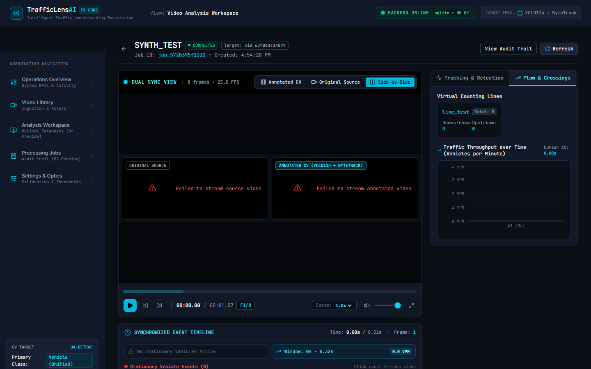
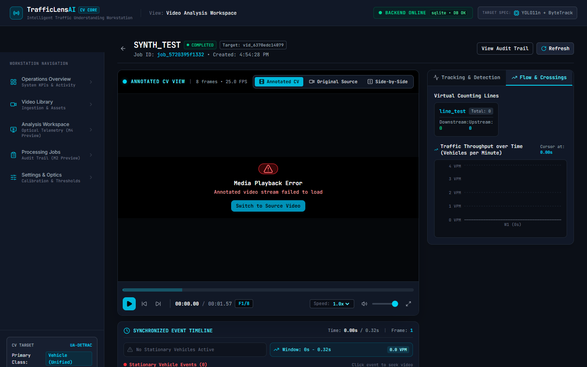
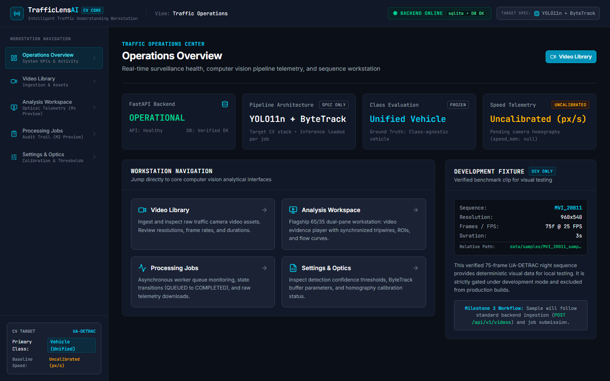
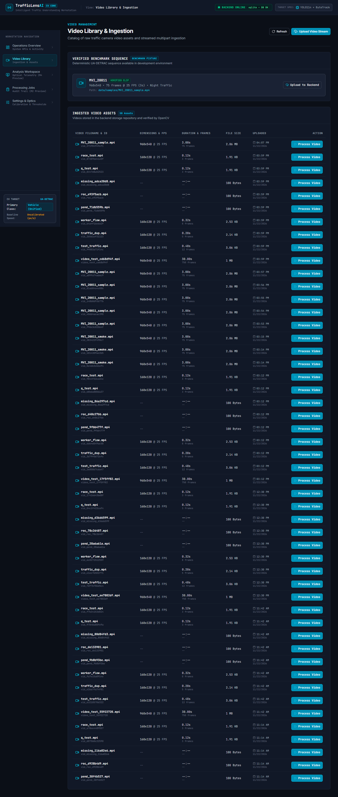
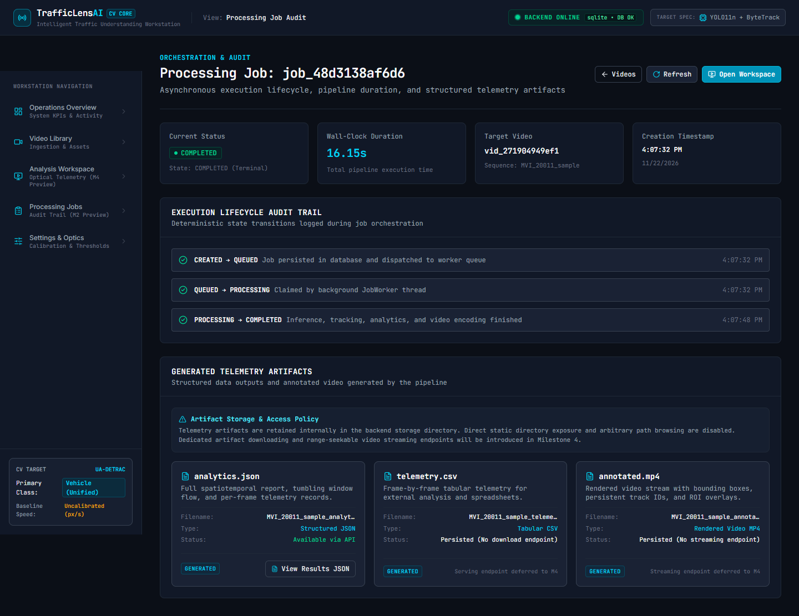
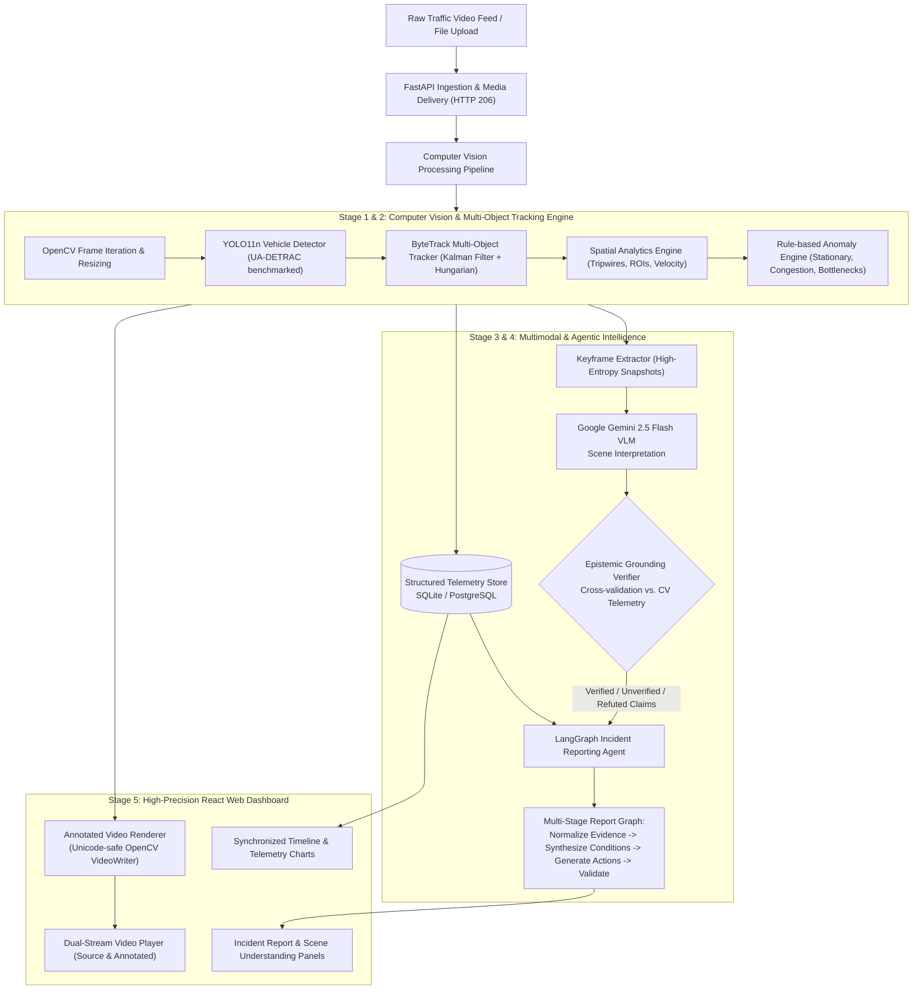

# TrafficLens-AI 🚦🔍

> **Intelligent traffic understanding, multi-object tracking, multimodal scene interpretation, and agentic incident reporting platform.**

[](https://www.python.org/)
[](https://fastapi.tiangolo.com/)
[](https://react.dev/)
[](https://www.typescriptlang.org/)
[](https://pytorch.org/)
[](https://opencv.org/)
[](https://ai.google.dev/)
[](https://langchain-ai.github.io/langgraph/)

---

## 📌 Project Overview

**TrafficLens-AI** transforms raw traffic camera video feeds into structured, actionable, and epistemically grounded traffic intelligence. Combining high-throughput Computer Vision (CV), persistent Multi-Object Tracking (MOT), state-of-the-art Multimodal Vision-Language Models (Gemini VLM), and autonomous LangGraph agent workflows, TrafficLens-AI automates:

- **High-Accuracy Vehicle Detection & Tracking**: Continuous identification and trajectory preservation for cars, buses, vans, and trucks across challenging traffic scenarios.
- **Micro-Level Spatial Analytics**: Dynamic vehicle counting over directional tripwires, polygon queue density tracking in user-defined Regions of Interest (ROIs), dwell time analysis, and uncalibrated pixel-displacement speed estimation.
- **Rule-Based Anomaly & Event Detection**: Instant identification of stationary vehicles, congestion bottlenecks, illegal movements, and sudden flow rate changes.
- **Multimodal Scene Understanding**: Keyframe-grounded visual analysis using Google Gemini 2.5 Flash, attributing weather conditions, road surface hazards, and driver behaviors.
- **Epistemic Claim Grounding**: Eliminates AI hallucination by cross-verifying VLM claims against ground-truth CV telemetry before presenting observations.
- **Automated Incident Reporting**: LangGraph-orchestrated generation of structured, executive-ready incident reports complete with hazard chronologies, spatial conditions, and prioritized advisory recommendations.
- **Dual-Stream Synchronized Dashboard**: Millisecond-accurate dual-player interface synchronizing raw source video with rendered CV overlays and live interactive telemetry.

---

## 📸 Visual Preview & Application Tour

### 1. Interactive Analysis Workspace (Dual-Stream Synchronized Inspection)
The core analysis workspace features a responsive dual video player synchronizing the original camera footage with the OpenCV-rendered annotated stream (bounding boxes, persistent track IDs, velocity vectors, and polygonal ROIs). Scrubbing or seeking on either player keeps telemetry graphs, classification counts, and event logs in lockstep.



---

### 2. Spatial Traffic Analytics & Flow Monitoring
Operators can inspect directional tripwire crossings, classification breakdowns (cars, buses, trucks, vans), speed distributions, and polygonal ROI occupancy over time with zero lag.



---

### 3. Central Operations Overview
Provides a real-time command-center view across active video streams, compute health, queue latency, completed processing jobs, and detected traffic anomalies.



---

### 4. Video Asset Library & Ingestion Pipeline
Centralized management of uploaded surveillance footage with codec validation, frame rate analysis, video resolution inspection, and one-click CV pipeline triggering.



---

### 5. Detailed Job Execution & Artifact Diagnostics
Every job tracks progress stage-by-stage (video decoding, detection, tracking, spatial analytics, video rendering, and artifact registration) with downloadable JSON telemetry and HTTP 206 Partial Content video streaming.



---

## ⚙️ How TrafficLens AI Works (Working of the Project)

TrafficLens-AI operates as an end-to-end multi-stage pipeline designed for determinism, high performance, and epistemic reliability.



---

### Step-by-Step System Workflow

#### 1. Video Ingestion & Streaming
- Operators upload video files (MP4, AVI, MOV) through the React UI or REST API.
- The backend validates video integrity, decodes metadata (FPS, dimensions, frame count, source codec), and stores the media asset.
- Both raw source media and generated annotated videos are served with **HTTP 206 Partial Content** support, enabling smooth byte-range seeking across long recordings.

#### 2. Computer Vision Detection & Tracking Engine
- **Vehicle Detection (`YOLO11n`)**: Each decoded frame is evaluated against an optimized vehicle detector trained on the UA-DETRAC benchmark. Context-specific evaluation ignore regions (sky, pedestrian sidewalks) are masked to prevent false positives.
- **Multi-Object Tracking (`ByteTrack`)**: Detected bounding boxes are associated across frames using a two-stage association strategy:
  1. High-confidence detections are matched to existing tracklets using motion prediction (Kalman filters) and spatial overlap (IoU distance).
  2. Low-confidence detections are subsequently matched to unmatched tracklets to maintain vehicle identity through severe occlusions, reflections, and brief stops.
- **Spatial Analytics Engine**:
  - **Directional Tripwires**: Tracks crossing orientation vectors to compute directional vehicle counts and lane throughput.
  - **Polygonal ROIs**: Computes 2D point-in-polygon vehicle containment to determine real-time queue density and vehicle dwell time.
  - **Speed Estimation**: Measures displacement over time as pixel displacement (`px/s`). Speeds are intentionally reported in uncalibrated pixel displacement to respect epistemic boundaries until camera homography calibration is performed.

#### 3. Fault-Tolerant Annotated Video Generation
- Rendered frames with color-coded bounding boxes, persistent track IDs, motion trajectories, tripwires, and active ROIs are composited into an MP4 video artifact.
- Built-in **Unicode-safe filename sanitization** prevents Windows/Linux path encoding mismatches.
- Multi-codec candidate fallbacks (`avc1`, `H264`, `X264`, `mp4v`) ensure compatible video creation in headless and containerized environments.
- Automated post-render verification tests that the created video artifact can be opened and decoded before it is registered in the database.

#### 4. Multimodal Scene Understanding (Google Gemini 2.5 Flash)
- **Keyframe Extraction**: High-entropy frames are automatically extracted at critical event timestamps (e.g., sudden deceleration, queue buildup, stopped vehicles).
- **VLM Evidence Packaging**: Extracted keyframes and structured CV telemetry summaries are packaged into structured multimodal prompts.
- **Semantic Inference**: Google Gemini 2.5 Flash analyzes the scene to identify environmental context (wet road surfaces, glare, rain, low light), spatial hazards, and causal factors that pure CV bounding boxes cannot capture.

#### 5. Epistemic Claim Grounding Verification
- To prevent generative hallucinations from compromising traffic safety decisions, every natural-language claim made by the VLM is parsed and cross-checked by an automated **Grounding Verifier**:
  - `VERIFIED`: The claim is directly substantiated by underlying CV detection, tracking, or spatial telemetry data.
  - `UNVERIFIED`: The claim describes visual context outside structured CV telemetry (e.g., weather or wet pavement) and is tagged with lower epistemic confidence.
  - `REFUTED`: The claim contradicts CV telemetry (e.g., asserting 10 vehicles when telemetry measured only 2) and is explicitly flagged or rejected.

#### 6. Autonomous Incident Reporting Agent (LangGraph)
- A multi-node LangGraph agent ingests the verified scene claims and CV telemetry to compile an official Incident Report:
  - **Node 1 (`evidence_normalizer`)**: Formats telemetry timestamps, track histories, and keyframe references into a unified evidence graph.
  - **Node 2 (`traffic_condition_synthesizer`)**: Summarizes overall road state, throughput levels, and density states.
  - **Node 3 (`event_timeline_generator`)**: Establishes a timestamped chronology of contributing anomalies.
  - **Node 4 (`recommendation_agent`)**: Formulates actionable advisory recommendations for traffic operations personnel.
  - **Node 5 (`grounding_validator`)**: Conducts a final pass ensuring that all assertions maintain strict provenance back to telemetry evidence.

#### 7. Synchronized Web Dashboard
- Built with React 18, TypeScript, Tailwind CSS, and TanStack Query.
- Features a unified **Synchronized Timeline** where operators can scrub through footage, click on detected events or VLM keyframe timestamps, and immediately navigate both video players and telemetry charts to the exact millisecond of the incident.

---

## 🏗️ Architecture

TrafficLens-AI follows a **Modular Monolith** architecture designed for maintainability, high performance, and rapid engineering iteration:

```
TrafficLens-AI/
├── docs/                         # Architecture Decision Records, Audits & Screenshots
│   ├── adr/                      # ADRs (ADR-0001 through ADR-0006)
│   ├── screenshots/              # UI walkthrough screenshots & visual previews
│   └── agents/                   # Agent operational rules & guidelines
├── backend/                      # Production FastAPI Backend Application
│   ├── app/
│   │   ├── api/routes/           # REST endpoints (videos, jobs, interpretation, reports)
│   │   ├── core/                 # App configuration, settings, logging
│   │   ├── db/                   # Database session & models (SQLAlchemy)
│   │   ├── models/               # ORM entities (Video, Job, SceneInterpretation, IncidentReport)
│   │   ├── repositories/         # Data access layer
│   │   ├── schemas/              # Pydantic validation schemas
│   │   ├── services/             # Core business logic:
│   │   │   ├── cv_pipeline_adapter.py    # YOLO11n + ByteTrack CV pipeline execution
│   │   │   ├── media_delivery.py         # HTTP 206 Partial Content video streaming
│   │   │   ├── vlm/                      # Keyframe extraction & Gemini VLM integration
│   │   │   └── agent/                    # LangGraph incident reporting agent
│   │   ├── dependencies.py       # FastAPI dependency injection
│   │   └── main.py               # Application entrypoint
│   └── tests/                    # 382+ automated unit, integration, and pipeline tests
├── frontend/                     # React + Vite + Tailwind CSS Web Application
│   ├── src/
│   │   ├── components/           # Dual VideoPlayer, TelemetryPanel, Scene & Report panels
│   │   ├── pages/                # OperationsOverview, VideoLibrary, AnalysisWorkspace, JobDetails
│   │   ├── services/             # Axios API client services
│   │   ├── hooks/                # React Query hooks for real-time polling
│   │   ├── state/                # Zustand workspace synchronization store
│   │   └── types/                # Strict TypeScript contracts matching backend Pydantic models
│   ├── package.json
│   └── vite.config.ts
├── experiments/                  # Isolated ML experimentation workspace
│   ├── configs/                  # Benchmark configurations (YAML)
│   ├── src/                      # UA-DETRAC parser, benchmark evaluator, TrackEval integration
│   └── third_party/              # TrackEval submodule
├── GLOSSARY.md                   # Canonical domain vocabulary & terminology
├── AGENTS.md                     # Agent development rules
└── requirements.txt              # Production Python dependencies
```

---

## 🔬 Dataset & Evaluation Strategy

Model development and benchmarking center on the **UA-DETRAC** benchmark:
- **Curated Subset**: A representative benchmark subset of sequences covering diverse conditions (day, night, sunny, rainy, heavy traffic) for fast, reproducible iterations.
- **Annotation Integrity**: Original XML annotations, vehicle identities, speed attributes, and evaluation ignore regions are rigorously preserved.
- **Baseline First**: Off-the-shelf pretrained models benchmarked as a baseline prior to any fine-tuning.
- **Evaluation Metrics**:
  - **Detection**: mAP@0.5, mAP@0.5:0.95 evaluated strictly against ground truth with ignore regions excluded.
  - **Tracking**: MOTA (Multi-Object Tracking Accuracy), IDF1, and HOTA (Higher Order Tracking Accuracy) alongside ID switches (IDSW) and fragmentation.

---

## 📊 Pretrained YOLO11n Detection Baseline Results

Evaluated on held-out test sequences (`MVI_20011` [night] & `MVI_40131` [rainy]) at optimal validation-tuned threshold ($conf=0.25$, $IoU=0.50$):

| Metric | Benchmark Score | Description |
| :--- | :--- | :--- |
| **AP@0.50** | **93.77%** | Mean Average Precision across vehicle detections (101-point COCO interpolation) |
| **AP@0.75** | **76.51%** | Strict localization threshold |
| **AP@0.50:0.95** | **64.19%** | 10-step mean Average Precision |
| **Precision@0.50** | **93.05%** | Accuracy of positive detections |
| **Recall@0.50** | **91.84%** | Ground truth coverage |
| **F1-Score@0.50** | **92.44%** | Harmonic balance between Precision and Recall |
| **Throughput** | **~8.3 FPS (121.1 ms)** | Pure model inference on CPU (batch size 16, $640 \times 640$) |

---

## 🎯 ByteTrack Multi-Object Tracking Baseline Results

Evaluated on held-out test sequences (`MVI_20011` & `MVI_40131`) using frozen validation-tuned parameters ($track\_high=0.40$, $track\_low=0.10$, $match\_thresh=0.70$, $track\_buffer=45$) via official **TrackEval** and **motmetrics**:

| Metric | Benchmark Score | Description |
| :--- | :--- | :--- |
| **HOTA** | **68.46%** | Higher Order Tracking Accuracy (unified detection & association) |
| **DetA** | **67.55%** | Detection Accuracy (mean over 19 localization thresholds) |
| **AssA** | **69.51%** | Association Accuracy (trajectory consistency over time) |
| **MOTA** | **81.37%** | Multiple Object Tracking Accuracy (CLEAR metric) |
| **IDF1** | **87.06%** | Global identity preservation |
| **ID Switches (IDSW)** | **12** | Total identity swaps across 2,309 test frames |
| **Mostly Tracked (MT)** | **93** | Vehicles tracked for $\ge 80\%$ of their trajectory |
| **Mostly Lost (ML)** | **1** | Vehicles tracked for $\le 20\%$ of their trajectory |
| **End-to-End Latency** | **116.38 ms** | Combined detection (113.37 ms) + ByteTrack update (3.01 ms) |
| **End-to-End Throughput** | **8.6 FPS** | Real-time tracking pipeline on CPU |

---

## 🗺️ Development Roadmap

| Phase | Milestone | Deliverables & Acceptance Criteria | Status |
| :--- | :--- | :--- | :--- |
| **Phase 0** | **Architecture & Scaffolding** | Repository layout, ADR-0001, GLOSSARY.md, and roadmap finalized. | ✅ Completed |
| **Phase 1** | **Dataset Curation & CV Baseline** | UA-DETRAC XML parser with ignore-region handling, 8-sequence curated split, PyTorch YOLO11n detection baseline (AP@0.50: 93.77%, F1: 92.44%), ByteTrack MOT baseline (HOTA: 68.46%, MOTA: 81.37%, IDF1: 87.06%). | ✅ Completed |
| **Phase 2** | **Core Backend & Ingestion** | FastAPI async video processing endpoints, OpenCV frame reader, in-process PyTorch pipeline runner, SQLAlchemy models with SQLite persistence, bounded job queues. | ✅ Completed |
| **Phase 3** | **Event Engine & Analytics** | Rule-based event detection (stationary vehicles, congestion onset, directional line crossings, ROI occupancy), keyframe snapshot extraction, telemetry exports. | ✅ Completed |
| **Phase 4** | **Frontend Web Dashboard** | Modern React + Vite + Tailwind dashboard, dual video player (source & annotated), real-time synchronized telemetry inspection, and ROI visualization. | ✅ Completed |
| **Phase 5** | **Multimodal VLM & Incident Agent** | Gemini 2.5 Flash VLM scene understanding with epistemic claim grounding, and LangGraph-based evidence-grounded traffic incident reporting agent. | ✅ Completed |
| **Phase 7** | **Integration Verification & E2E** | End-to-end live multimodal workflow verification, live Gemini inference, fault-tolerant Unicode video encoding, and comprehensive test suite validation. | ✅ Completed |

---

## 🚀 Running the Project Locally

### 1. Prerequisites
- Python 3.10+ (tested on Python 3.11)
- Node.js 18+ and npm
- (Optional) Google Gemini API Key for live multimodal VLM scene interpretation

### 2. Backend Setup
```bash
# Clone the repository
git clone https://github.com/Ritik4259/TrafficLens-AI.git
cd TrafficLens-AI

# Install Python dependencies
pip install -r requirements.txt

# Configure environment variables
cp .env.example .env
# Edit .env to set your GEMINI_API_KEY if testing live VLM inference

# Run database migrations
alembic upgrade head

# Start FastAPI backend server (http://127.0.0.1:8000)
python -m uvicorn backend.app.main:app --host 127.0.0.1 --port 8000 --reload
```

### 3. Frontend Setup
```bash
# In a new terminal, navigate to the frontend directory
cd frontend

# Install dependencies
npm install

# Start Vite development server (http://127.0.0.1:3000)
npm run dev
```

### 4. Running Automated Tests
```bash
# Backend pytest suite (382 tests)
pytest

# Frontend vitest suite (79 tests)
npm --prefix frontend test

# Production build check
npm --prefix frontend run build
```

---

## ⚠️ Known Limitations & Epistemic Boundaries

1. **Camera Calibration & Speed Measurement**:
   - The platform strictly prohibits displaying speeds in `km/h` or `mph` without camera homography matrix calibration. Speeds are reported as uncalibrated pixel displacement (`px/s`).
2. **Tracker Instance Semantics**:
   - Vehicle counts reflect tracked identities (`Track #ID`). Under severe occlusions or camera jitter, tracklet fragmentation may lead to higher track counts than unique physical vehicles.
3. **Congestion Heuristics**:
   - Spatial occupancy levels are rule-based 2D bounding-box coverage heuristics, labeled with `EXPLAINABLE HEURISTIC`, and should not be treated as certified highway capacity determinations.
4. **Advisory Decision Support**:
   - All incident report recommendations are strictly advisory and must never be connected directly to automated signal actuators without human-in-the-loop validation.
5. **Hardware & Throughput**:
   - In-process CV detection and tracking achieves ~8.6 FPS on modern CPUs. Real-time multi-stream deployment requires CUDA-enabled GPU acceleration.
6. **Live Gemini Inference**:
   - Requires setting `GEMINI_API_KEY` in `.env` and enabling `VLM_ENABLED=true`. When absent, the incident agent seamlessly operates using deterministic offline mock providers for testing.

---

## 📜 Domain Language & Architecture Decisions

- All terminology adheres strictly to [GLOSSARY.md](./GLOSSARY.md). Please consult the glossary before introducing new entity definitions or domain concepts.
- Architectural choices and rationales are recorded in [docs/adr/](./docs/adr/):
  - [ADR-0001: Modular Monolith Architecture and Core Decisions](./docs/adr/0001-modular-monolith-architecture.md)
  - [ADR-0002: Backend Architecture & Ingestion Design](./docs/adr/0002-backend-architecture.md)
  - [ADR-0003: Frontend Architecture and Design System](./docs/adr/0003-frontend-architecture-and-design-system.md)
  - [ADR-0004: Multimodal VLM Integration Architecture](./docs/adr/0004-vlm-integration-architecture.md)
  - [ADR-0005: VLM Job Orchestration & Grounding](./docs/adr/0005-vlm-job-orchestration.md)
  - [ADR-0006: Evidence-Grounded Incident Reporting Agent](./docs/adr/0006-evidence-grounded-incident-agent.md)
