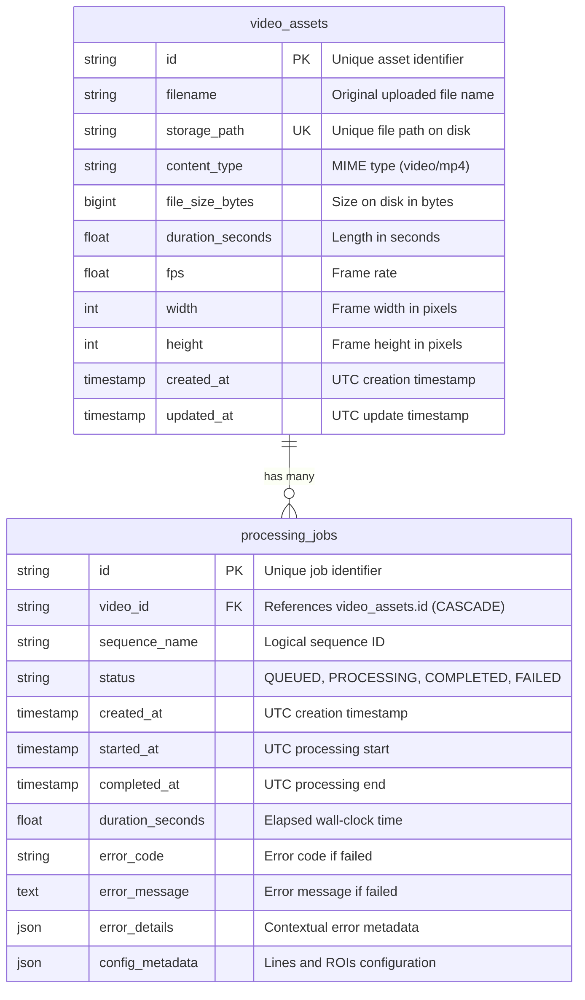

# TrafficLens-AI — Backend API Contracts Specification

This document provides the formal contract specification for all endpoints, request bodies, response payloads, and data structures exposed by the TrafficLens-AI backend service.

---

## 1. Global Conventions & Standards

- **Protocol**: HTTP/1.1 or HTTP/2 over TLS.
- **Data Exchange Format**: JSON (`application/json`).
- **Timestamps**: ISO 8601 UTC strings (`YYYY-MM-DDTHH:MM:SS.mmmmmmZ`).
- **Coordinate System**: 2D pixel space `(x, y)` origin `(0.0, 0.0)` at the top-left of the image frame.
  - Horizontal axis: $x \in [0.0, \text{frame\_width}]$.
  - Vertical axis: $y \in [0.0, \text{frame\_height}]$.
- **Bounding Box Format**: Absolute pixel coordinates `(left, top, width, height)`.
- **Units**:
  - Time durations: Seconds (`float`).
  - Throughput: Vehicles Per Minute (`float`).
  - Spatial Occupancy Ratio: Dimensionless fraction $[0.0, 1.0]$ (`float`).
  - Uncalibrated Speed: Pixels per second (`float`).
  - Calibrated Speed: Kilometers per hour (`Optional[float]`).

---

## 2. Asynchronous Job Lifecycle State Machine

Video processing is managed asynchronously using a 4-state lifecycle:

```
          ┌─────────────┐
          │   QUEUED    │
          └──────┬──────┘
                 │
       ┌─────────┴─────────┐
       ▼                   ▼
┌──────────────┐    ┌──────────────┐
│  PROCESSING  │    │    FAILED    │ (Terminal)
└──────┬───────┘    └──────────────┘
       │                   ▲
       ├───────────────────┘
       ▼
┌──────────────┐
│  COMPLETED   │ (Terminal)
└──────────────┘
```

### Allowed State Transitions

| Current Status | Target Status | Allowed? | Trigger / Context |
| :--- | :--- | :---: | :--- |
| `QUEUED` | `PROCESSING` | **Yes** | Background worker begins video decoding & inference. |
| `QUEUED` | `FAILED` | **Yes** | Video validation fails (unsupported codec, corrupt file). |
| `PROCESSING` | `COMPLETED` | **Yes** | Full video processed; telemetry and media generated. |
| `PROCESSING` | `FAILED` | **Yes** | Exception during CV inference or analytics execution. |
| `COMPLETED` | *Any* | **No** | Terminal state. Cannot re-process or fail a completed job. |
| `FAILED` | *Any* | **No** | Terminal state. Cannot transition from a failed state. |
| `QUEUED` | `COMPLETED` | **No** | Processing cannot be skipped. |

Any illegal transition raises `InvalidJobStatusTransitionError` (HTTP 409 Conflict).

---

## 3. Endpoints Reference

### 3.1 Health & Service Metadata
`GET /api/v1/health`

Returns operational health status, active software version, and database dialect.

#### Response (HTTP 200 OK)
```json
{
  "status": "healthy",
  "service": "TrafficLens-AI",
  "version": "0.1.0",
  "environment": "development",
  "database_dialect": "sqlite"
}
```

---

### 3.2 Upload Video File
`POST /api/v1/videos`

Streams a multipart video file to disk, verifies video stream readability and decodability with OpenCV, extracts native video metadata, and registers a `VideoAsset` record in the database.

- **Content-Type**: `multipart/form-data`
- **Request Form Field**: `file` (Binary video file)
- **Supported Formats**: `.mp4`, `.avi`, `.mov`, `.mkv`
- **Size Limit**: 500 MB (`MAX_UPLOAD_SIZE_BYTES`)

#### Response (HTTP 201 Created, `VideoUploadResponseSchema`)
```json
{
  "video_id": "vid_a1b2c3d4e5f6",
  "metadata": {
    "video_id": "vid_a1b2c3d4e5f6",
    "filename": "highway_traffic.mp4",
    "content_type": "video/mp4",
    "file_size_bytes": 15482910,
    "duration_seconds": 26.56,
    "fps": 25.0,
    "width": 960,
    "height": 540,
    "frame_count": 664,
    "uploaded_at": "2026-11-21T16:48:12.100000Z"
  },
  "message": "Video uploaded successfully and validated."
}
```

---

### 3.3 Get Video Metadata
`GET /api/v1/videos/{video_id}`

Retrieves metadata for an existing uploaded video asset.

#### Response (HTTP 200 OK, `VideoMetadataSchema`)
```json
{
  "video_id": "vid_a1b2c3d4e5f6",
  "filename": "highway_traffic.mp4",
  "content_type": "video/mp4",
  "file_size_bytes": 15482910,
  "duration_seconds": 26.56,
  "fps": 25.0,
  "width": 960,
  "height": 540,
  "frame_count": 664,
  "uploaded_at": "2026-11-21T16:48:12.100000Z"
}
```

---

### 3.4 Stream Source Video Media
`GET /api/v1/videos/{video_id}/content`

Streams the uploaded source video media file with RFC 9110 HTTP Range support for video players and seeking.

- **Security & Path Resolution**: Resolves the media file strictly through the persisted database record. Enforces server-side path containment within the configured upload directory (`storage/uploads/`). Rejects path traversal attempts (HTTP 400 Bad Request). Never accepts filesystem paths from client requests.
- **Memory Management**: Yields chunks in bounded 256 KB buffers using a generator, ensuring minimal server RAM utilization regardless of video size.
- **Range Support**:
  - `bytes=start-end`: Returns 206 Partial Content with `Content-Range: bytes start-end/total`.
  - `bytes=start-`: Returns 206 Partial Content from offset to EOF.
  - `bytes=-suffix`: Returns 206 Partial Content for the trailing byte range.
  - No Range header or invalid syntax: Returns 200 OK with full content.
  - Unsatisfiable ranges (e.g. `start >= total_size` or `start > end`): Returns 416 Range Not Satisfiable with `Content-Range: bytes */total`.
- **Media Content-Type**: Standard media MIME type resolved from asset record or file extension (`video/mp4`, `video/x-msvideo`, `video/quicktime`, `video/x-matroska`).

#### Request Headers (Optional)
```http
Range: bytes=0-1048575
```

#### Response (HTTP 206 Partial Content)
```http
HTTP/1.1 206 Partial Content
Accept-Ranges: bytes
Content-Range: bytes 0-1048575/15482910
Content-Length: 1048576
Content-Type: video/mp4
Cache-Control: private, no-store

[Binary chunked video payload]
```

---

### 3.5 Create Job for Uploaded Video
`POST /api/v1/videos/{video_id}/jobs`

Submits an uploaded video asset for asynchronous CV pipeline processing.

- **Idempotency / Conflict Policy**: If an active job is already `QUEUED` or `PROCESSING` for this video, the request is rejected with **HTTP 409 Conflict**.

#### Request Body (`ProcessingJobCreateSchema`, Optional)
```json
{
  "sequence_name": "MVI_20011",
  "lines": [
    {
      "line_id": "line_downstream",
      "name": "Main Road Crossline",
      "p1": [420.0, 270.0],
      "p2": [880.0, 270.0],
      "positive_direction_label": "downstream",
      "negative_direction_label": "upstream",
      "cooldown_frames": 15,
      "min_track_age": 2
    }
  ],
  "rois": [
    {
      "roi_id": "roi_main_road",
      "name": "Active Roadway",
      "polygon": [
        [480.0, 100.0],
        [820.0, 100.0],
        [940.0, 520.0],
        [520.0, 520.0]
      ],
      "description": "Main multilane vehicular roadway"
    }
  ]
}
```

#### Response (HTTP 202 Accepted, `ProcessingJobResponseSchema`)
```json
{
  "job_id": "job_a1b2c3d4e5f6",
  "video_id": "vid_a1b2c3d4e5f6",
  "sequence_name": "MVI_20011",
  "status": "QUEUED",
  "created_at": "2026-11-21T16:50:00.000000Z",
  "started_at": null,
  "completed_at": null,
  "duration_seconds": null,
  "error": null
}
```

---

### 3.6 Create Processing Job (Direct)
`POST /api/v1/jobs`

Legacy/direct endpoint submitting a video asset for processing. Requires `video_id` in request body.

#### Request Body (`ProcessingJobCreateSchema`)
```json
{
  "video_id": "vid_9f82b1c4",
  "sequence_name": "MVI_20011",
  "lines": [
    {
      "line_id": "line_downstream",
      "name": "Main Road Crossline",
      "p1": [420.0, 270.0],
      "p2": [880.0, 270.0],
      "positive_direction_label": "downstream",
      "negative_direction_label": "upstream",
      "cooldown_frames": 15,
      "min_track_age": 2
    }
  ]
}
```

#### Response (HTTP 202 Accepted, `ProcessingJobResponseSchema`)
```json
{
  "job_id": "job_a1b2c3d4e5f6",
  "video_id": "vid_9f82b1c4",
  "sequence_name": "MVI_20011",
  "status": "QUEUED",
  "created_at": "2026-11-21T16:50:00.000000Z",
  "started_at": null,
  "completed_at": null,
  "duration_seconds": null,
  "error": null
}
```

---

### 3.7 Get Job Status
`GET /api/v1/jobs/{job_id}`

Retrieves current lifecycle status, execution timestamps, and error details (if failed).

#### Response (HTTP 200 OK, `ProcessingJobResponseSchema`)
```json
{
  "job_id": "job_a1b2c3d4e5f6",
  "video_id": "vid_9f82b1c4",
  "sequence_name": "MVI_20011",
  "status": "COMPLETED",
  "created_at": "2026-11-21T16:50:00.000000Z",
  "started_at": "2026-11-21T16:50:02.100000Z",
  "completed_at": "2026-11-21T16:51:20.300000Z",
  "duration_seconds": 78.2,
  "error": null
}
```

---

### 3.8 Get Job Results & Artifacts
`GET /api/v1/jobs/{job_id}/results`

Returns comprehensive spatiotemporal results and disk artifact locations for a completed job.

- **Status Code 409 Conflict**: Returned if the job is still in progress (`QUEUED` or `PROCESSING`), or if the job `FAILED`.
- **Status Code 200 OK**: Returned when job is `COMPLETED`.

#### Response (HTTP 200 OK, `JobResultsResponseSchema`)
```json
{
  "job_id": "job_a1b2c3d4e5f6",
  "video_id": "vid_a1b2c3d4e5f6",
  "sequence_name": "MVI_20011",
  "status": "COMPLETED",
  "duration_seconds": 78.2,
  "detection_summary": {
    "total_detections": 23214,
    "mean_confidence": 0.8124,
    "class_distribution": {
      "car": 21050,
      "bus": 1240,
      "truck": 924
    }
  },
  "tracking_summary": {
    "total_unique_tracks": 65,
    "mostly_tracked_count": 31,
    "mostly_lost_count": 1,
    "id_switches": 2,
    "mota": 0.7663,
    "hota": 0.6417,
    "idf1": 0.8646
  },
  "analytics_summary": {
    "sequence_name": "MVI_20011",
    "total_frames": 664,
    "duration_s": 26.56,
    "fps": 25.0,
    "total_unique_vehicles": 65,
    "line_counts": {
      "line_downstream": {
        "downstream": 25,
        "upstream": 0,
        "total": 25
      }
    },
    "flow_windows": [
      {
        "line_id": "line_downstream",
        "window_start_s": 0.0,
        "window_end_s": 26.56,
        "total_count": 25,
        "flow_rate_vpm": 56.48,
        "direction_counts": {
          "downstream": 25
        },
        "direction_flows_vpm": {
          "downstream": 56.48
        }
      }
    ],
    "stopped_vehicle_events": [
      {
        "track_id": 6,
        "start_frame": 1,
        "start_timestamp_s": 0.0,
        "end_frame": 664,
        "end_timestamp_s": 26.52,
        "duration_s": 26.52,
        "location": [101.0, 156.1],
        "roi_id": "roi_side_zone",
        "status": "resolved"
      }
    ],
    "peak_occupancy_per_roi": {
      "roi_main_road": 0.4362,
      "roi_side_zone": 0.4230
    },
    "average_occupancy_per_roi": {
      "roi_main_road": 0.1746,
      "roi_side_zone": 0.3437
    },
    "congestion_distribution_per_roi": {
      "roi_main_road": {
        "low": 293,
        "moderate": 361,
        "high": 10
      },
      "roi_side_zone": {
        "low": 0,
        "moderate": 75,
        "high": 589
      }
    }
  },
  "artifacts": {
    "analytics_json": "storage/outputs/job_a1b2c3d4e5f6/analytics.json",
    "telemetry_csv": "storage/outputs/job_a1b2c3d4e5f6/telemetry.csv",
    "annotated_video": "storage/outputs/job_a1b2c3d4e5f6/annotated.mp4"
  }
}
```

---

### 3.9 Stream Annotated Video Media
`GET /api/v1/jobs/{job_id}/annotated-video`

Streams the rendered output video with bounding boxes and trajectory trails for a `COMPLETED` processing job.

- **Status Code 409 Conflict**: Returned if the job is still in progress (`QUEUED` or `PROCESSING`) or `FAILED`.
- **Status Code 404 Not Found**: Returned if the job does not exist, or if the annotated video artifact was not generated or is missing on disk.
- **Status Code 403 Forbidden**: Returned if the artifact path escapes the configured output directory (`storage/outputs/`).
- **Range Seeking**: Fully compliant with RFC 9110 HTTP Range semantics (`206 Partial Content`, `Content-Range`, `Accept-Ranges: bytes`).

#### Request Headers (Optional)
```http
Range: bytes=0-1048575
```

#### Response (HTTP 206 Partial Content)
```http
HTTP/1.1 206 Partial Content
Accept-Ranges: bytes
Content-Range: bytes 0-1048575/8421950
Content-Length: 1048576
Content-Type: video/mp4
Cache-Control: private, no-store

[Binary chunked video payload]
```

---

### 3.10 List Job Artifacts
`GET /api/v1/jobs/{job_id}/artifacts`

Lists all output artifacts generated by a `COMPLETED` job with verified on-disk availability, clean filenames, data categories, and relative serving endpoints. Never returns server filesystem paths.

- **Status Code 409 Conflict**: Returned if the job is in `QUEUED`, `PROCESSING`, or `FAILED` state.
- **Status Code 404 Not Found**: Returned if the job does not exist.

#### Response (HTTP 200 OK, `JobArtifactsResponseSchema`)
```json
{
  "job_id": "job_a1b2c3d4e5f6",
  "status": "COMPLETED",
  "artifacts": [
    {
      "name": "analytics_json",
      "filename": "seq_MVI_20011_analytics.json",
      "artifact_type": "json",
      "is_available": true,
      "file_size_bytes": 48210,
      "serving_url": "/api/v1/jobs/job_a1b2c3d4e5f6/results"
    },
    {
      "name": "telemetry_csv",
      "filename": "seq_MVI_20011_telemetry.csv",
      "artifact_type": "csv",
      "is_available": true,
      "file_size_bytes": 128440,
      "serving_url": null
    },
    {
      "name": "annotated_video",
      "filename": "seq_MVI_20011_annotated.mp4",
      "artifact_type": "video",
      "is_available": true,
      "file_size_bytes": 8421950,
      "serving_url": "/api/v1/jobs/job_a1b2c3d4e5f6/annotated-video"
    }
  ]
}
```

---

### 3.11 Get Job Telemetry
`GET /api/v1/jobs/{job_id}/telemetry`

Returns comprehensive spatiotemporal analytics, detection metrics, and tracking summaries.

#### Response (HTTP 200 OK, `JobTelemetryResponseSchema`)
```json
{
  "job_id": "job_a1b2c3d4e5f6",
  "video_id": "vid_9f82b1c4",
  "sequence_name": "MVI_20011",
  "detection_summary": {
    "total_detections": 23214,
    "mean_confidence": 0.8124,
    "class_distribution": {
      "car": 21050,
      "bus": 1240,
      "truck": 924
    }
  },
  "tracking_summary": {
    "total_unique_tracks": 65,
    "mostly_tracked_count": 31,
    "mostly_lost_count": 1,
    "id_switches": 2,
    "mota": 0.7663,
    "hota": 0.6417,
    "idf1": 0.8646
  },
  "analytics_summary": {
    "sequence_name": "MVI_20011",
    "total_frames": 664,
    "duration_s": 26.56,
    "fps": 25.0,
    "total_unique_vehicles": 65,
    "line_counts": {
      "line_downstream": {
        "downstream": 25,
        "upstream": 0,
        "total": 25
      }
    },
    "flow_windows": [
      {
        "line_id": "line_downstream",
        "window_start_s": 0.0,
        "window_end_s": 26.56,
        "total_count": 25,
        "flow_rate_vpm": 56.48,
        "direction_counts": {
          "downstream": 25
        },
        "direction_flows_vpm": {
          "downstream": 56.48
        }
      }
    ],
    "stopped_vehicle_events": [
      {
        "track_id": 6,
        "start_frame": 1,
        "start_timestamp_s": 0.0,
        "end_frame": 664,
        "end_timestamp_s": 26.52,
        "duration_s": 26.52,
        "location": [101.0, 156.1],
        "roi_id": "roi_side_zone",
        "status": "resolved"
      }
    ],
    "peak_occupancy_per_roi": {
      "roi_main_road": 0.4362,
      "roi_side_zone": 0.4230
    },
    "average_occupancy_per_roi": {
      "roi_main_road": 0.1746,
      "roi_side_zone": 0.3437
    },
    "congestion_distribution_per_roi": {
      "roi_main_road": {
        "low": 293,
        "moderate": 361,
        "high": 10
      },
      "roi_side_zone": {
        "low": 0,
        "moderate": 75,
        "high": 589
      }
    }
  }
}
```

---

## 4. Error Payload Specification

All client (4xx) and server (5xx) errors adhere to `ProcessingErrorSchema`:

```json
{
  "error_code": "INVALID_STATUS_TRANSITION",
  "message": "Cannot transition job status from COMPLETED to PROCESSING. Allowed target states: [].",
  "details": {
    "current_status": "COMPLETED",
    "requested_status": "PROCESSING",
    "job_id": "job_a1b2c3d4e5f6"
  },
  "occurred_at": "2026-11-21T16:55:00.000000Z"
}
```

### Canonical Error Codes

| Code | HTTP Status | Description |
| :--- | :---: | :--- |
| `CORRUPT_OR_EMPTY_VIDEO` | 400 | Uploaded file is empty (0 bytes) or OpenCV cannot decode frames. |
| `RESOURCE_NOT_FOUND` | 404 | Requested job_id or video_id does not exist. |
| `ACTIVE_JOB_CONFLICT` | 409 | Video already has an active job in `QUEUED` or `PROCESSING` state. |
| `INVALID_STATUS_TRANSITION` | 409 | Prohibited transition between job lifecycle states. |
| `RESULTS_NOT_READY` | 409 | Job is still in progress or failed; results cannot be retrieved. |
| `FILE_TOO_LARGE` | 413 | Uploaded video exceeds `MAX_UPLOAD_SIZE_BYTES` (500 MB). |
| `UNSUPPORTED_MEDIA_TYPE` | 415 | File extension or MIME type not in allowed list (`.mp4`, `.avi`, `.mov`, `.mkv`). |
| `RANGE_NOT_SATISFIABLE` | 416 | Requested byte range is outside file bounds or inverted. |
| `INVALID_PAYLOAD` | 422 | Request body failed Pydantic schema validation. |
| `INFERENCE_FAILURE` | 500 | Exception encountered during PyTorch/YOLO/ByteTrack execution. |

---

## 5. Database Persistence Mapping & ERD

The persistence layer mirrors the external API contracts using SQLAlchemy 2.0 ORM models while decoupling relational persistence from web presentation schemas.

### 5.1 Entity-Relationship Model



### 5.2 Schema to Model Mapping

| API Schema | SQLAlchemy Model | Primary Key | Key Relationships |
| :--- | :--- | :--- | :--- |
| `VideoMetadataSchema` | `VideoAsset` (`video_assets`) | `id` | One-to-many with `ProcessingJob` (`jobs`) |
| `ProcessingJobResponseSchema` | `ProcessingJob` (`processing_jobs`) | `id` | Many-to-one with `VideoAsset` (`video_asset`) |
| `ProcessingErrorSchema` | Decomposed into `ProcessingJob` columns (`error_code`, `error_message`, `error_details`) | — | Embedded in `processing_jobs` |
| `CountingLineConfigSchema` / `ROIConfigSchema` | Serialized in `ProcessingJob.config_metadata` | — | Embedded JSON in `processing_jobs` |

### 5.3 Persistence Boundaries
To avoid catastrophic relational write amplification, individual frame-level detections (e.g. 23,000+ bounding boxes in `MVI_20011`) are **never persisted as relational rows**. Only aggregated sequence telemetry (`TrafficAnalyticsSummarySchema`), line flows, and discrete events (`StoppedVehicleEventSchema`) are stored.

---

## 6. Backend Media Delivery & Streaming Architecture

### 6.1 Objective & Design Principles
The backend media delivery subsystem provides streaming video playback and artifact delivery for both uploaded source videos and computer vision-annotated results without exposing host server filesystem paths to the frontend or public web.

### 6.2 HTTP Range Semantics (RFC 9110)
Media endpoints (`GET /api/v1/videos/{video_id}/content` and `GET /api/v1/jobs/{job_id}/annotated-video`) implement standard single byte-range requests:
- **Caching Policy**: All media delivery responses (200, 206, and 416) consistently include `Cache-Control: private, no-store` to prevent caching of video media across shared proxies or untrusted local disks.
- **Full Content (200 OK)**: Delivered when the `Range` header is absent or syntactically invalid. Contains `Accept-Ranges: bytes`, `Content-Length: {total_size}`, `Content-Type`, and `Cache-Control: private, no-store`.
- **Partial Content (206 Partial Content)**: Delivered when a valid single byte range is requested:
  - `bytes=start-end`: Returns slice $[start, end]$ inclusive.
  - `bytes=start-`: Returns slice $[start, total\_size - 1]$ inclusive.
  - `bytes=-suffix`: Returns the trailing $suffix$ bytes $[total\_size - suffix, total\_size - 1]$.
  - Headers returned: `Accept-Ranges: bytes`, `Content-Range: bytes {start}-{end}/{total_size}`, `Content-Length: {end - start + 1}`, and `Cache-Control: private, no-store`.
- **Range Not Satisfiable (416)**: Returned when $start \ge total\_size$, $start > end$, or when Range is requested on a 0-byte file. Headers returned: `Content-Range: bytes */{total_size}`, `Accept-Ranges: bytes`, and `Cache-Control: private, no-store`.

### 6.3 Memory & Chunking Architecture
To prevent out-of-memory crashes on large video assets (up to 500 MB), the server **never loads entire video files into RAM**. Media chunks are read sequentially in 256 KB buffers using a Python generator (`file_chunk_generator`) and streamed via Starlette's `StreamingResponse`.

### 6.4 Security & Path Traversal Protections
1. **Zero Static Directory Mounts**: The backend does NOT expose `./storage/` or `./storage/uploads/` via FastAPI `StaticFiles`. The filesystem is completely unmounted.
2. **Database-Driven Ownership**: Every media delivery request resolves through database records (`VideoAsset` or `ProcessingJob`). Clients cannot pass filesystem paths.
3. **Server-Side Directory Containment**: All target paths are strictly resolved on the server and verified using `path.resolve().is_relative_to(permitted_directory.resolve())`. Any traversal attempt (e.g., `../`, null bytes, alternate drive paths) immediately raises HTTP 400 Bad Request or HTTP 403 Forbidden.
4. **Physical On-Disk Verification**: Artifacts are validated via `path.exists()` and `path.is_file()` before streaming or reporting availability.
5. **Clean Metadata Exposure**: The `GET /api/v1/jobs/{job_id}/artifacts` endpoint exposes only clean filenames (basenames), data formats (`json`, `csv`, `video`), verified availability booleans, byte sizes, and relative API endpoints. Absolute and server paths are strictly hidden.

### 6.5 Current Access Control Boundaries & Limitations
- **Authentication**: User authentication is **not yet implemented**. Endpoints are accessible within the local/private network perimeter. Access tokens, cookies, or RBAC headers should not be assumed until authentication is introduced in a future milestone.
- **Multipart Byteranges**: Multiple ranges (e.g. `bytes=0-50, 100-200`) are not supported; per RFC 9110, requests with multiple ranges safely fall back to full 200 OK content.
- **CSV Delivery**: No arbitrary file download endpoint is provided for tabular CSV telemetry. Structured JSON telemetry is served via `GET /api/v1/jobs/{job_id}/results`.
