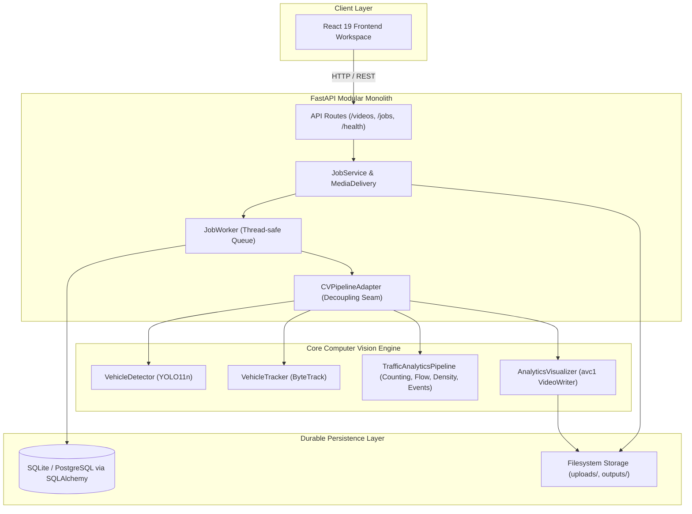
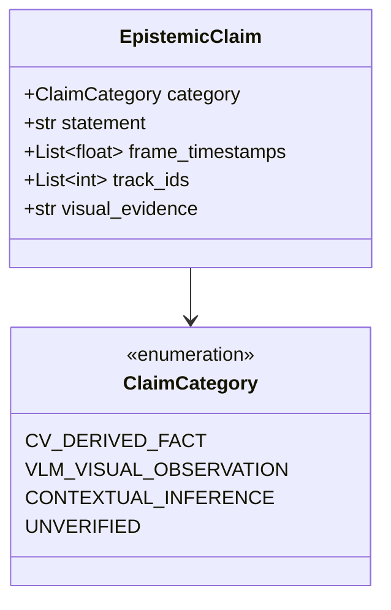
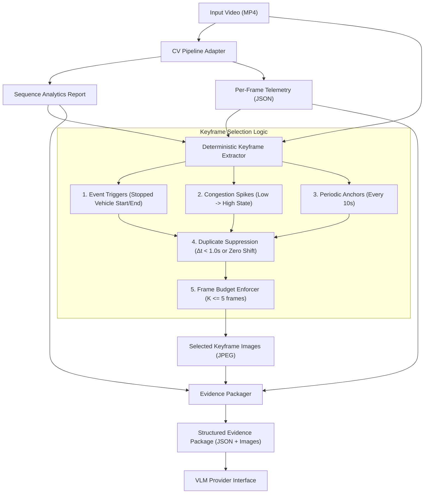
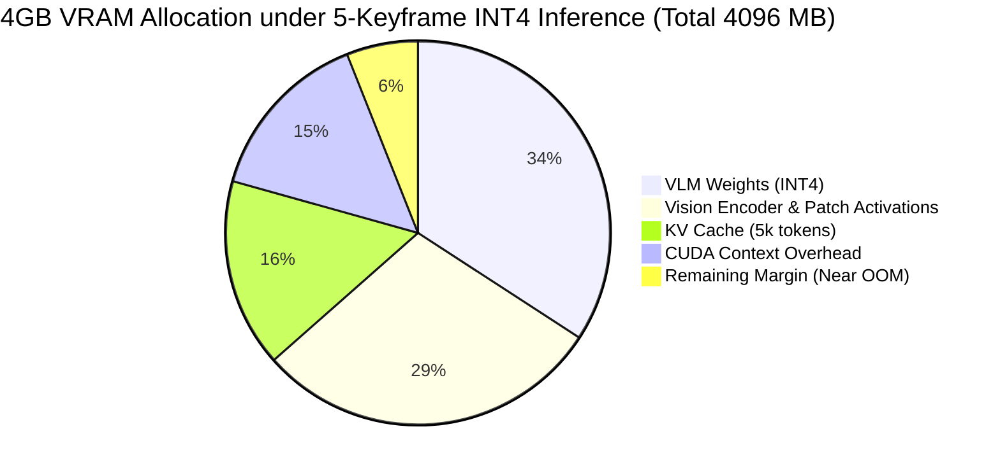
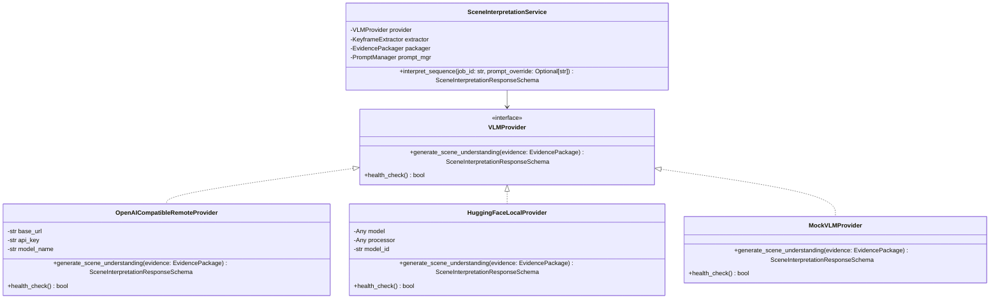
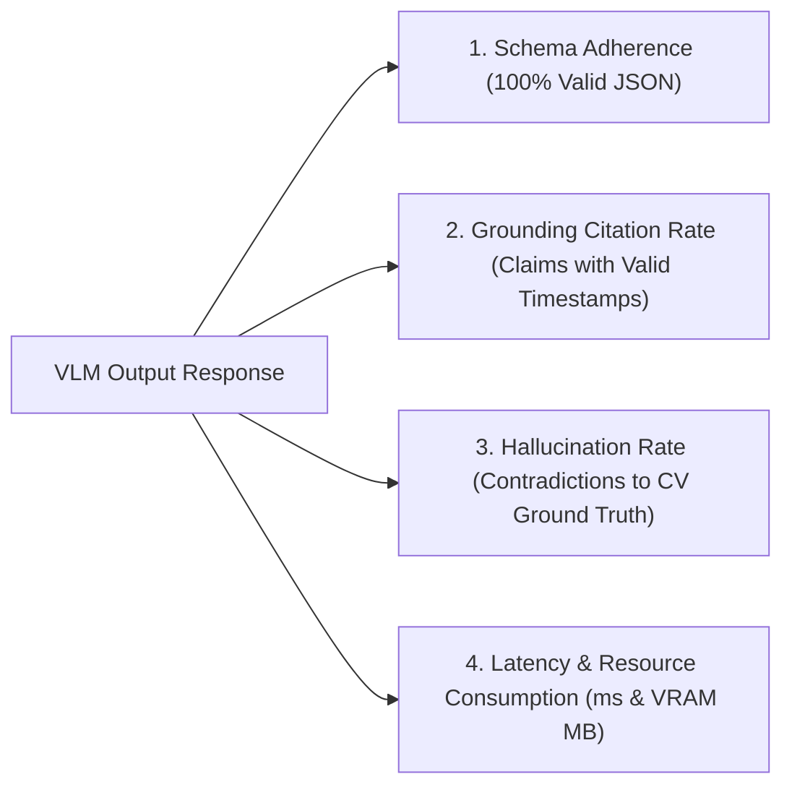

# TrafficLens AI — VLM Architecture, Multimodal Evidence Pipeline & Model Feasibility

**Document Version**: 1.0.0  
**Phase**: Milestone 5A (Multimodal Scene Understanding Architecture)  
**Status**: Approved Architecture & Feasibility Specification  
**Date**: November 22, 2026  

---

## 1. Executive Summary

TrafficLens-AI has established an end-to-end computer vision and spatiotemporal analytics pipeline (YOLO11n vehicle detection, ByteTrack multi-object tracking, tripwire directional counting, tumbling window flow calculation, polygonal ROI density estimation, and stationary vehicle detection). While this deterministic engine produces rigorous numerical telemetry, it cannot reason qualitatively about the operational environment. It measures *that* a vehicle stopped, but cannot discern *why* it stopped; it quantifies spatial occupancy, but cannot describe road weather or surface hazards; it computes flow rates, but cannot explain visual blockages or unusual driver maneuvers.

**Milestone 5A** addresses this gap by designing a **Multimodal Scene Understanding Architecture** powered by Vision-Language Models (VLMs). 

### Key Principles of this Architecture:
1. **Strict Epistemic Division of Responsibilities**: Computer vision models own 100% of numerical and physical measurements (counts, speeds, positions, tracking identities, durations). The VLM enriches this foundation with qualitative contextual interpretation, environmental classification, and grounded explanations.
2. **Deterministic Multimodal Evidence Pipeline**: Video frames are not blindly streamed into the VLM. Instead, a deterministic keyframe extraction algorithm selects a strictly bounded set ($K \le 5$) of event-triggered and periodic anchor frames, paired with a compact, structured telemetry evidence package.
3. **Rigorous Hardware Grounding**: Acknowledging our physical hardware boundary (NVIDIA RTX 2050 Laptop GPU with 4 GB VRAM, 8 GB total system RAM with ~1 GB free, and a CPU-only active PyTorch environment), we evaluate model candidates with brutal realism. Local unquantized 2B execution is physically infeasible; we architect an interchangeable provider pattern prioritizing an **OpenAI-compatible remote/hosted endpoint** for `Qwen/Qwen3-VL-2B-Instruct` with a **4-bit quantized local fallback** using `HuggingFaceTB/SmolVLM2-2.2B-Instruct`.
4. **Model-Agnostic Seams & Clean Boundaries**: Core FastAPI routes and CV pipelines remain completely isolated from VLM libraries. All VLM communication flows through a typed `VLMProvider` protocol.
5. **Zero Hallucination & Calibrated Confidence**: Every model assertion is categorized into strict epistemic bins (`CV-derived fact`, `visual observation`, `contextual inference`, or `unverified`) with mandatory citations to timestamps and track IDs.

---

## 2. Review of Existing Architecture & Integration Seams

To ensure that Milestone 5 builds directly upon established foundations without breaking contracts or duplicating functionality, we review the existing system boundaries:



### Existing Seams Utilized by Milestone 5:
1. **Decoupled CV Adapter Seam (`CVPipelineAdapter`)**:
   `CVPipelineAdapter.process_video_file` currently executes detection, tracking, and spatiotemporal analytics, returning:
   - `SequenceAnalyticsReport` (overall summary, cumulative line crossings, tumbling flow windows, stopped vehicle events, peak/average ROI occupancies).
   - `analytics_json`: Full sequence telemetry exported to disk, including frame-by-frame telemetry (`FrameTelemetry`).
   - `annotated_video`: Browser-compatible H.264 video.
   Milestone 5 does not modify this execution loop. Instead, the resulting structured telemetry becomes the primary input to the VLM Evidence Packager.
2. **Asynchronous Processing State Machine (`JobWorker`)**:
   Jobs transition through `QUEUED -> PROCESSING -> COMPLETED / FAILED`. VLM scene interpretation is integrated either as an optional asynchronous enrichment stage following CV completion or as an on-demand post-processing query.
3. **Verified Telemetry Schemas (`backend/app/schemas/telemetry.py`)**:
   Contains typed models for `StoppedVehicleEventSchema`, `LineFlowSchema`, `ROIDensitySchema`, `CongestionStateSchema`, and `TrafficAnalyticsSummarySchema`. These schemas form the core data dictionary for evidence prompt construction.
4. **Media Delivery APIs (`media_delivery.py`)**:
   Provides secure, validated byte-range streaming (`/api/v1/videos/{video_id}/content` and `/api/v1/jobs/{job_id}/annotated-video`) with `Cache-Control: private, no-store`. Keyframe extraction utilities can directly leverage the validated filesystem storage paths resolved by the media delivery service.

---

## 3. VLM Functional Scope & Epistemic Boundaries

### 3.1 What the VLM MUST Do
1. **Traffic Scene & Geometry Description**:
   - Classify camera perspective (overhead gantry, elevated pole, roadside oblique).
   - Identify roadway layout (divided highway, multi-lane arterial, intersection, entrance/exit ramp).
   - Describe visible static infrastructure (lane markings, concrete barriers, pedestrian sidewalks, medians).
2. **Environmental & Road Condition Interpretation**:
   - Assess ambient lighting conditions (bright daylight, overcast, dawn/dusk twilight, night illumination).
   - Identify weather phenomena visible in the scene (clear, rainfall, fog, optical haze).
   - Detect road surface conditions (dry asphalt, water pooling, specular road reflections, snow/ice).
3. **Qualitative Explanation of Traffic Events**:
   - Provide contextual reasoning for stationary vehicle events:
     - *Is the vehicle stopped in an active lane behind a traffic queue?*
     - *Is the vehicle stopped at a signalized intersection or crosswalk?*
     - *Is the vehicle parked on the road shoulder or curb with hazard lights active?*
     - *Is the vehicle involved in a visual stall or mechanical breakdown?*
4. **Visual Obstruction & Anomaly Identification**:
   - Detect temporary roadway anomalies (construction pylons/cones, road debris, maintenance equipment).
   - Identify visual occlusions affecting detection (tree foliage, bridge overhangs, extreme lens glare, camera vibration).
5. **Evidence-Grounded Query Answering**:
   - Formulate clear, concise natural-language answers to user questions concerning specific temporal intervals (e.g., *"Why did average flow drop between 00:15 and 00:30?"*).

### 3.2 What the VLM MUST NOT Do (Anti-Goals)
1. **Must NOT Calculate Numerical Metrics**:
   The VLM must not count vehicles, estimate traffic volumes, measure vehicle speeds in km/h, or assign tracking IDs.
2. **Must NOT Overwrite or Contradict CV Ground Truth**:
   If the ByteTrack tracker identified 14 unique vehicle identities, the VLM must not claim "there are 6 cars in the video". It must explicitly incorporate the CV measurement: *"The tracking engine recorded 14 unique vehicle tracks across this sequence..."*
3. **Must NOT Fabricate Inter-Frame Events**:
   If an event is not visible within the provided keyframes, the model must not speculate that an off-camera accident or collision occurred between frames.
4. **Must NOT Assert Speculation as Ground Truth**:
   The model must not state: *"The vehicle stopped because the driver had a flat tire"* unless a flat tire is unequivocally visible. It must use calibrated probabilistic phrasing: *"The vehicle is stationary on the right shoulder with hazard flashers active, suggesting an emergency stop or mechanical issue."*

### 3.3 Epistemic Categorization Framework

Every analytical claim generated by the system is tagged with one of four epistemic categories:



| Epistemic Category | Definition | Example Statement | Validation Source |
| :--- | :--- | :--- | :--- |
| **`cv_fact`** | Direct quantitative output from YOLO, ByteTrack, or Spatiotemporal Analytics. | *"Track #7 remained stationary at coordinates (342, 185) for 12.4 seconds."* | `analytics_json` |
| **`visual_observation`** | Physical scene feature directly visible in one or more keyframes. | *"Wet pavement with high specular headlight reflections is visible across both lanes."* | Keyframe Image @ 04.20s |
| **`inference`** | Model-generated qualitative hypothesis linking observations to CV facts. | *"Track #7 stopped due to lane obstruction caused by a delivery truck ahead."* | VLM Reasoning |
| **`unverified`** | Plausible condition that cannot be confirmed from the camera field of view. | *"Traffic signal phase governing the intersection is outside the camera FOV."* | Explicit Model Caveat |

---

## 4. Multimodal Evidence Pipeline Architecture

Feeding continuous video frames into a multi-billion parameter VLM is computationally prohibitive, latency-inducing, and wasteful. The **Multimodal Evidence Pipeline** solves this by deterministically distilling an entire video sequence into a compact, information-dense evidence package.



### 4.1 Deterministic Keyframe Selection Algorithm & Implementation

The `KeyframeExtractor` (`backend/app/services/vlm/keyframe_extractor.py`) executes a fully deterministic, prioritized multi-stage extraction procedure:

1. **Candidate Frame Harvesting**:
   - **Stationary Vehicle Events (Priority 1 & 2)**:
     - *Start Frame (Priority 1)*: Clamped `start_timestamp_s` converted to `frame_idx = round(start_timestamp_s * fps)`. Importance score equals the event's `duration_s`.
     - *Pre-Event Context Frame (Priority 4)*: If `include_pre_event_context=True` and $t_{\text{start}} \ge \text{pre\_event\_offset\_s}$, captures the approach frame $t_{\text{pre}} = t_{\text{start}} - 1.0\text{s}$ (importance: $0.5 \times \text{duration\_s}$).
     - *Resolution Frame (Priority 2)*: If `end_timestamp_s` is provided and $> t_{\text{start}}$, captures $t_{\text{end}}$ (importance: $0.8 \times \text{duration\_s}$).
   - **Congestion & Occupancy Transitions (Priority 2)**:
     - For each `CongestionState` with `moderate` or `high` level, captures the transition frame (importance: $\text{occupancy\_ratio} \times 10.0$).
   - **Periodic Scene Anchors (Priority 3)**:
     - Uniformly samples baseline scene anchors across sequence duration ($t = [0.05 \times D, 0.50 \times D, 0.95 \times D]$ or up to 5 intervals for sequences $\ge 15.0\text{s}$). Importance score equals $1.0$.
2. **Deterministic Deduplication & Near-Duplicate Suppression**:
   - Candidates are sorted by `(priority, -importance_score, timestamp_s)`.
   - Any candidate within $\Delta t < \text{min\_event\_interval\_s}$ (default $1.0\text{ s}$) of an already accepted candidate is evaluated:
     - If both candidates refer to the **same event** or if one candidate is a generic anchor/context frame, the lower-priority duplicate is pruned and logged in `diagnostics.candidates_pruned_duplicate`.
     - If both candidates represent **distinct physical events** (different vehicle `track_id` or different event type), both are preserved to maintain multi-vehicle event visibility.
3. **Deterministic Frame Budget Enforcement ($K \le 5$)**:
   - Top $K$ candidates are selected based on `(priority, -importance_score, frame_idx)`.
   - Remaining candidates are dropped, incrementing `diagnostics.candidates_pruned_budget`.
   - The final selected candidates are **re-sorted chronologically** by `frame_idx` to guarantee sequential visual coherence for the VLM.
4. **Behavior When Candidates are Fewer than $K$**:
   - When event candidates $< K$, the algorithm automatically supplements with periodic anchors spaced evenly across the duration to fulfill the budget.
   - If the video sequence itself has fewer frames than $K$ (e.g. short clips with $N < 5$ frames), all available valid frames are extracted, and a diagnostic warning is logged. The extractor never fabricates frames or timestamps.
5. **Timestamp Correctness & Stream Robustness**:
   - **No Reliance on `CAP_PROP_POS_MSEC`**: OpenCV millisecond reporting is frequently inaccurate on compressed MP4 files due to B-frame presentation offsets. Timestamps are derived strictly from integer frame indices and verified FPS: $\text{timestamp\_s} = \text{round}(\text{frame\_idx} / \text{fps}, 3)$.
   - **FPS Fallback**: If stream FPS is $\le 0$ or non-finite, the extractor falls back to caller-supplied metadata FPS, or defaults to 25.0 FPS with a diagnostic warning.
   - **Out-of-Range Clamping**: Candidate frame indices $< 0$ or $\ge \text{total\_frames}$ are clamped to $[0, \text{total\_frames} - 1]$ with logged warnings.
   - **Empty / Corrupt Stream Protection**: Files with 0 bytes or unreadable stream headers immediately raise `VideoReadError`.
   - **Aspect-Ratio Preserving Downscaling**: If $\max(H, W) > \text{max\_dimension}$ (default 960), the frame is resized using `cv2.INTER_AREA` while preserving the exact original aspect ratio.
   - **Guaranteed Resource Cleanup**: All OpenCV stream handles are released inside `finally: cap.release()`.

### 4.2 Compact Evidence Package Structure

The `EvidencePackager` (`backend/app/services/vlm/evidence_packager.py`) bundles the extracted keyframes and CV telemetry:
- **Internal Contract (`EvidencePackageSchema`)**: Includes full base64 JPEG image strings (`KeyframeDetailSchema`) for direct dispatch to VLM providers.
- **Public API Contract (`EvidencePackagePublicSchema`)**: Generated via `.to_public_schema()`. Strictly strips raw base64 binary strings and local server filesystem paths, providing lightweight JSON with keyframe IDs, dimensions, timestamps, selection reasons, event references, and telemetry summaries.

```json
{
  "evidence_package_id": "evpkg_job_67890_5k",
  "job_id": "job_67890",
  "video_id": "vid_12345",
  "sequence_name": "seq_vid_830fca407675",
  "created_at": "2026-11-22T15:21:00Z",
  "keyframes": [
    {
      "keyframe_id": "kf_job_67890_1",
      "source_video_id": "vid_12345",
      "source_job_id": "job_67890",
      "frame_idx": 1,
      "timestamp_s": 0.04,
      "selection_reason": "scene_anchor_pct_5",
      "associated_event_ids": [],
      "width": 640,
      "height": 360
    },
    {
      "keyframe_id": "kf_job_67890_280",
      "source_video_id": "vid_12345",
      "source_job_id": "job_67890",
      "frame_idx": 280,
      "timestamp_s": 11.20,
      "selection_reason": "stopped_vehicle_start_track_4",
      "associated_event_ids": ["stop_4_11.20"],
      "width": 640,
      "height": 360
    }
  ],
  "events": [
    {
      "event_id": "stop_4_11.20",
      "event_type": "stopped_vehicle",
      "track_id": 4,
      "timestamp_s": 11.20,
      "duration_s": 11.60,
      "roi_id": "roi_main",
      "details": {
        "end_timestamp_s": 22.80,
        "status": "resolved",
        "location": [318.5, 142.0]
      }
    }
  ],
  "telemetry_summary": {
    "total_unique_tracks": 14,
    "total_detections": 1820,
    "mean_confidence": 0.88,
    "total_frames": 750,
    "duration_s": 30.0,
    "fps": 25.0
  },
  "diagnostics": {
    "total_candidates_identified": 9,
    "candidates_pruned_duplicate": 2,
    "candidates_pruned_budget": 2,
    "extracted_frame_count": 5,
    "warnings": []
  }
}
```

### 4.3 Vision Token Accounting & Estimation Notice

> [!NOTE]
> The previously estimated 5,050-token context budget is an architectural baseline estimate based on standard SigLIP patch dimensions ($14 \times 14$ patches on $960 \times 540$ frames), not a guaranteed fixed token limit. Actual token consumption varies across model architectures:
> - **SigLIP / SmolVLM2**: Approximately 729 visual tokens per image.
> - **Qwen-VL / Qwen3-VL**: Dynamic patch resolution (28x28 base patches) typically produces 256 to 1,280 visual tokens per image depending on aspect ratio and native resolution scaling.
> The $K \le 5$ frame budget guarantees that total multimodal prompt size remains well within the 8k–256k context boundaries of all candidate models.

### 4.4 Known Limitations of the Evidence Pipeline

1. **Fixed Camera Geometry Assumption**: The pipeline assumes stationary surveillance or traffic monitoring cameras. Extreme camera pans or zooming will cause spatial coordinate distortion unless camera homography parameters are supplied.
2. **Temporal Granularity**: A hard budget of $K \le 5$ keyframes prioritizes the most significant events. In sequences with more than 5 distinct, non-overlapping stopped vehicle incidents, lower-duration incidents will not receive a dedicated visual keyframe (though their numerical records are preserved in the structured telemetry summary).
3. **Uncalibrated Speed Invariance**: In accordance with the project's strict provenance rules, vehicle speed remains uncalibrated in pixels/second unless homography matrices are provided. The evidence packager never fabricates metric km/h values.

---

## 5. Model Candidate Deep-Dive & Hardware Feasibility Analysis

### 5.1 Candidate Model Comparison

| Evaluation Dimension | Candidate 1: `Qwen/Qwen3.5-2B` | Candidate 2: `Qwen/Qwen3-VL-2B-Instruct` | Candidate 3: `HuggingFaceTB/SmolVLM2-2.2B-Instruct` |
| :--- | :--- | :--- | :--- |
| **Model Architecture** | Hybrid Gated Delta / MoE text backbone | Vision Transformer + Qwen3 LLM with Interleaved-MRoPE | SigLIP Vision Encoder + SmolLM2-1.7B Language Decoder |
| **Total Parameter Count** | $\approx 2.1\text{B}$ | $\approx 2.2\text{B}$ | $\approx 2.2\text{B}$ (Vision: 400M, Language: 1.7B) |
| **Native Modality** | Text-first (multimodal extension) | Native Video, Multi-Image & Text | Native Video, Multi-Image & Text |
| **Open Source License** | Apache 2.0 | Apache 2.0 | Apache 2.0 |
| **Transformers Support** | Yes (`AutoModelForCausalLM`) | Yes (`Qwen3VLForConditionalGeneration`) | Yes (`AutoModelForImageTextToText`, Idefics3) |
| **Quantization Formats** | GGUF, AWQ, FP8, bitsandbytes (4-bit/8-bit) | GGUF, AWQ, FP8, bitsandbytes | bitsandbytes (NF4, 8-bit), GGUF |
| **FP16 Weight Footprint** | $\approx 4.2\text{ GB}$ | $\approx 4.4\text{ GB}$ | $\approx 4.5\text{ GB}$ |
| **INT4 Weight Footprint** | $\approx 1.2\text{ GB}$ | $\approx 1.3\text{ GB}$ | $\approx 1.4\text{ GB}$ |
| **Active Runtime VRAM (FP16)** | $\approx 5.5\text{ GB}$ | $\approx 5.8\text{ GB}$ | $\approx 5.9\text{ GB}$ |
| **Active Runtime VRAM (INT4)** | $\approx 2.4\text{ GB}$ | $\approx 2.6\text{ GB}$ | $\approx 2.5\text{ GB}$ |
| **Multi-Image Grounding** | Moderate | **Outstanding** (Spatial BBox grounding) | **High** (Fine-tuned on video/image sequences) |
| **Structured JSON Adherence** | High | **Very High** | High |

### 5.2 Honest Hardware Feasibility Evaluation

Our local development workstation has the following physical specifications:
- **GPU**: NVIDIA GeForce RTX 2050 Laptop GPU (4,096 MiB / 4 GB VRAM).
- **System Memory**: 8 GB physical RAM total; available free RAM under Windows 11 + IDE + dev server load is typically **~750 MB to 1.2 GB**.
- **PyTorch Environment**: Currently installed as `2.15.0+cpu` (CPU-only build, no CUDA runtime).

#### Physical Constraint Assessment:



1. **Local CPU Inference (Zero GPU)**:
   - In FP16, loading 4.5 GB of weights into system RAM immediately exceeds the available ~800 MB free memory, forcing the Windows virtual memory manager into intense disk pagefile swapping.
   - In 4-bit CPU quantization (e.g., via llama.cpp/GGUF), weights occupy ~1.4 GB. While it can technically load into swap space, token generation speed on a mobile laptop CPU is estimated at **0.8 to 2.5 tokens/second**. Generating a 500-token response would require **3.5 to 10 minutes per request**, accompanied by complete system unresponsiveness.
2. **Local GPU Inference (RTX 2050 4 GB)**:
   - Requires replacing the CPU-only PyTorch build with a CUDA-enabled build (`torch==2.x+cu121`) and installing `bitsandbytes` or `llama-cpp-python` with CUDA acceleration.
   - **Weight Loading**: A 4-bit quantized model (`load_in_4bit=True`) consumes $\approx 1,400\text{ MB}$.
   - **CUDA Context & Runtime Buffer**: PyTorch and CUDA runtime initialization claim $\approx 500 - 600\text{ MB}$.
   - **Multimodal Token Activation Explosion**: Encoding 5 keyframes ($3,645\text{ vision tokens}$) requires substantial intermediate tensor buffers during self-attention in the vision encoder, demanding an additional $\approx 1,200 - 1,500\text{ MB}$ of VRAM.
   - **KV Cache for 5,000 Tokens**: $\approx 600 - 800\text{ MB}$.
   - **Total Estimated VRAM**: $1,400 + 600 + 1,300 + 700 = \mathbf{4,000\text{ MB}}$.
   - **Verdict**: Operating at $97.6\%$ of physical capacity creates an extreme risk of non-deterministic CUDA Out-Of-Memory (`CUDA: out of memory`) exceptions during peak vision encoding or batch execution, especially if external displays or desktop composition consume VRAM.
3. **Remote / Hosted Inference Endpoint**:
   - Serving the model via an external high-throughput engine (e.g. self-hosted vLLM or Ollama on an accelerated workstation, Hugging Face Serverless / Dedicated Endpoints, or standard multimodal APIs adhering to the OpenAI Vision format).
   - Local resource footprint: **0 MB VRAM, < 15 MB RAM** (HTTP request serialization only).
   - Latency: **1.5 to 3.5 seconds total wall-clock time**.
   - Reliability: 100% deterministic, no local thermal throttling or system freezes.

### 5.3 Model Recommendations

1. **Primary Recommendation**: **`Qwen/Qwen3-VL-2B-Instruct`**
   - **Deployment Mode**: Served via an **OpenAI-compatible HTTP provider** (e.g., vLLM or Ollama on a GPU server, or cloud multimodal endpoint).
   - **Rationale**: Qwen3-VL leads the 2B tier in spatial grounding, native Interleaved-MRoPE video sequence modeling, and strict JSON instruction-following. It was explicitly trained for spatial coordinate localization (`[ymin, xmin, ymax, xmax]`), allowing visual observations to link directly to bounding boxes in keyframes.
2. **Fallback Recommendation**: **`HuggingFaceTB/SmolVLM2-2.2B-Instruct`**
   - **Deployment Mode**: Local in-process execution using Hugging Face `transformers` with 4-bit `BitsAndBytesConfig` (or edge GGUF via llama.cpp).
   - **Rationale**: SmolVLM2 uses standard Apache 2.0 components (SigLIP + SmolLM2) with zero proprietary dependencies. Its native support for multi-image lists in chat templates (`"type": "image"`) makes it the cleanest local fallback for air-gapped or offline demonstrations.

---

## 6. System Architecture & Component Boundaries

The VLM integration follows a modular, dependency-inversion design pattern. No VLM library or vendor SDK is directly imported by FastAPI controllers or the CV pipeline.



### 6.1 Component Specifications

#### 1. `VLMProvider` (Protocol Boundary)
Located at `backend/app/services/vlm/provider.py`:
```python
from typing import Protocol, runtime_checkable
from backend.app.schemas.vlm import EvidencePackageSchema, SceneInterpretationResponseSchema

@runtime_checkable
class VLMProvider(Protocol):
    """Abstract protocol for multimodal vision-language model backends."""

    async def generate_scene_understanding(
        self,
        evidence: EvidencePackageSchema,
    ) -> SceneInterpretationResponseSchema:
        """Processes structured evidence package and returns validated scene understanding."""
        ...

    async def health_check(self) -> bool:
        """Returns True if the underlying inference engine or endpoint is reachable."""
        ...
```

#### 2. `KeyframeExtractor`
Located at `backend/app/services/vlm/keyframe_extractor.py`:
- Extracts video frames at exact timestamps and deterministic frame indices using OpenCV.
- Enforces strict timing provenance: prefers verified stream FPS, accepts valid caller metadata FPS fallback; if neither is available, **no assumed FPS (such as 25 FPS) is fabricated**.
- Robust nullable timestamps: when timing cannot be established reliably, `timestamp_s` remains `None` (`null`) while exact integer frame indices are strictly preserved.
- Prohibition of assumed-FPS mapping: discrete events specifying only timestamps without frame indices are skipped with diagnostic warnings rather than mapped via assumed FPS.
- Decoder seek correspondence & frame-index semantics:
  - In standard OpenCV backends, `CAP_PROP_POS_FRAMES` post-read represents the 0-based index of the *next* frame to be decoded ($n + 1$ after reading frame $n$). The decoded frame index is derived strictly as $\text{int}(\text{round}(\text{pos\_after})) - 1$ to prevent off-by-one errors and float truncation.
  - Preserves explicit distinction between `requested_frame_idx` and verified decoded `frame_idx`.
  - When decoder position is unavailable (`-1.0`), static (`0.0`), non-finite, or out-of-range, `is_verified` is explicitly set to `False` and diagnostic notices are emitted without falsely labeling unverified frames as verified.
  - When compressed container keyframe seeking lands on a diverged frame, the actual decoded frame index is verified and recorded with a diagnostic notice.
- Enforces duplicate suppression ($\Delta t < 1.0\text{s}$ or identical frame index) and maximum frame budget ($K \le 5$).
- Resizes frames to max dimension $\le 960\text{px}$ preserving aspect ratio and outputs high-quality JPEG byte buffers.
- Resource safety: guarantees `VideoCapture.release()` execution across all success and error paths via structured `try...finally`.

#### 3. `EvidencePackager`
Located at `backend/app/services/vlm/evidence_packager.py`:
- Ingests `SequenceAnalyticsReport`, `JobResultsResponseSchema`, and candidate keyframes.
- Filters and aggregates focal events (e.g. stopped vehicles, high congestion ROIs).
- Formulates a compact `EvidencePackageSchema` ready for model ingestion.

#### 4. `PromptManager`
Located at `backend/app/services/vlm/prompt_manager.py`:
- Constructs system instructions enforcing strict epistemic constraints:
  - *"You are an expert traffic intelligence engine. You will be provided with deterministic CV measurements and selected video keyframes. You MUST NOT invent vehicle counts or speeds. Classify every statement as cv_fact, visual_observation, inference, or unverified."*
  - *"DO NOT ASSERT that a stopped vehicle is an accident or mechanical breakdown without visible supporting evidence."*
- Assembles standard OpenAI-compatible vision message payloads interleaving keyframe text banners (`keyframe_id`, `frame_idx`, `selection_reason`) with base64 data URIs (`data:{content_type};base64,...`).

#### 5. `GeminiVLMProvider`
Located at `backend/app/services/vlm/gemini_provider.py`:
- Concrete VLM provider implementing Google's native Gemini REST API (`POST https://generativelanguage.googleapis.com/v1beta/models/{model}:generateContent`).
- Authenticates securely via `x-goog-api-key` header (never placed in URL query parameters, error payloads, or logs).
- Native multimodal request assembly interleaving epistemic prompt instructions, CV telemetry facts, and base64 `inlineData` keyframes with explicit metadata banners.
- OpenAPI/JSON Schema dereferencing for `generationConfig.responseSchema` with uppercase type specifications matching Gemini Protobuf schema requirements.
- Candidate finish reason evaluation (`STOP`, `SAFETY`, `RECITATION`, `MAX_TOKENS`) and prompt safety block checking (`promptFeedback.blockReason`).
- Grounding verification: audits all returned `keyframe_id`s and `event_id`s against the input `EvidencePackageSchema`. Automatically unlinks ungrounded keyframe references, demotes ungrounded visual claims to `unverified`, and appends explicit disclosures to `unverified_aspects`.
- Bounded exponential backoff retries for transient failures (HTTP 429, 500, 502, 503, 504, connection drops, read timeouts) while failing fast on non-retryable errors (HTTP 401, 403, 404, 400).
- Diagnostic health check endpoint: `GET https://generativelanguage.googleapis.com/v1beta/models/{model}` verifying endpoint reachability, credentials, and model availability.

#### 6. `OpenAICompatibleRemoteProvider`
Located at `backend/app/services/vlm/remote_provider.py`:
- Interacts with any OpenAI-compatible multimodal endpoint (vLLM, Ollama, OpenRouter, cloud multimodal APIs).
- Implements bounded retries, secret redaction, and strict grounding verification.

#### 7. `MockVLMProvider`
Located at `backend/app/services/vlm/mock_provider.py`:
- In-memory deterministic mock satisfying `VLMProvider` for offline development, CI/CD, and integration tests.
- Dynamically derives realistic, grounded interpretations matching supplied keyframes and events without network or GPU overhead.

#### 8. `SceneInterpretationService`
Located at `backend/app/services/vlm/scene_interpretation_service.py`:
- High-level domain orchestrator coordinating evidence packages, provider selection, and failure isolation.
- Resolves active provider based on `VLM_PROVIDER_TYPE` (`gemini`, `mock`, `openai_compatible`).
- Strict failure isolation: Catches provider errors (`VLMError` or unexpected exceptions) and returns a structured `SceneInterpretationResult` with failure details rather than raising unhandled exceptions. Primary CV processing jobs never fail due to downstream VLM errors.

### 6.2 Provider Environment Configuration

| Variable | Type | Default | Description |
| :--- | :--- | :--- | :--- |
| `VLM_ENABLED` | bool | `False` | Master switch enabling VLM scene interpretation. |
| `VLM_PROVIDER_TYPE` | str | `"gemini"` | Active provider backend (`gemini`, `mock`, `openai_compatible`). |
| `GEMINI_API_KEY` | str | `None` | Google Gemini API key (authenticated via `x-goog-api-key`; redacted in logs). |
| `GEMINI_MODEL` | str | `None` | Explicitly configured Gemini model identifier (e.g. `gemini-3.8-flash`, subject to availability for your API key). |
| `GEMINI_API_BASE_URL` | str | `"https://generativelanguage.googleapis.com/v1beta"` | Base URL for Google Generative Language REST API. |
| `VLM_REQUEST_TIMEOUT` | float | `30.0` | HTTP request timeout in seconds. |
| `VLM_MAX_RETRIES` | int | `2` | Maximum retry attempts for transient 429/5xx errors. |
| `VLM_MAX_OUTPUT_TOKENS` | int | `2048` | Maximum token limit for model completions. |
| `VLM_TEMPERATURE` | float | `0.2` | Sampling temperature for deterministic structured extraction. |

### 6.3 Model Discovery, Verification & Testing Boundaries

#### Dynamic Model Discovery via Google Gemini API
Google's Gemini model catalog evolves over time. Rather than hardcoding a default model in application code, `GEMINI_MODEL` is kept explicitly configurable.

To discover the current active models available for your Gemini API key, query Google's models endpoint directly:

```bash
# Query available models using your API key
curl -H "x-goog-api-key: $GEMINI_API_KEY" "https://generativelanguage.googleapis.com/v1beta/models"
```

#### Verifying Multimodal and generateContent Capabilities
When selecting a model identifier from the discovery response, verify:
1. **Method Support**: The model's `supportedGenerationMethods` list contains `"generateContent"`.
2. **Multimodal Input Support**: The model accepts image input modalities (`image/jpeg`, `image/png`).

Current documented reference model: `gemini-3.8-flash` (subject to availability for the user's specific API key).

> [!WARNING]
> **Mocked Tests Do Not Prove Model Availability**:
> The test suite in `backend/tests/test_vlm_provider_integration.py` runs with mocked HTTP transports (`httpx.MockTransport`) to verify protocol conformance, request formation, header authentication, retry logic, and schema parsing without network access. **Passing mocked tests does NOT prove that a model identifier is available or provisioned for your Gemini API key.** Model availability must be verified directly against the live `GET /v1beta/models` endpoint.

> [!NOTE]
> **Tested Mock Integration vs. Live Model Inference**: Milestone 5C implements and verifies the complete HTTP adapter, prompt payload formulation, retry logic, error taxonomy, and schema validation using mocked HTTP transports and `MockVLMProvider`. Real inference metrics (latency, empirical grounding rates, qualitative narrative accuracy) will be benchmarked in Milestone 5E once a live remote endpoint is provisioned.

---

## 7. Output Data Contracts (Pydantic v2 Schemas)

The output schemas ensure that every claim is strongly typed and verifiable against source telemetry.

```python
"""
Pydantic contracts for Vision-Language Model scene understanding.
File: backend/app/schemas/vlm.py
"""

from __future__ import annotations
from enum import Enum
from typing import Dict, List, Optional, Tuple, Any
from pydantic import BaseModel, Field, field_validator


class ClaimCategoryEnum(str, Enum):
    """Epistemic classification of an analytical statement."""
    CV_FACT = "cv_fact"
    VISUAL_OBSERVATION = "visual_observation"
    INFERENCE = "inference"
    UNVERIFIED = "unverified"


class ConfidenceCategoryEnum(str, Enum):
    """
    Categorical certainty indicator.
    
    Avoids arbitrary model-generated floating point probabilities.
    """
    DIRECT_OBSERVATION = "direct_observation"   # Directly visible in keyframe
    SUPPORTED_INFERENCE = "supported_inference" # Contextually deduced from CV + visuals
    SPECULATIVE_HYPOTHESIS = "speculative"     # Plausible but unconfirmed


class WeatherConditionEnum(str, Enum):
    CLEAR = "clear"
    OVERCAST = "overcast"
    RAIN = "rain"
    FOG = "fog"
    UNKNOWN = "unknown"


class IlluminationConditionEnum(str, Enum):
    DAYLIGHT = "daylight"
    TWILIGHT = "twilight"
    NIGHT = "night"
    UNKNOWN = "unknown"


class RoadSurfaceConditionEnum(str, Enum):
    DRY = "dry"
    WET_REFLECTIVE = "wet_reflective"
    SNOW_ICE = "snow_ice"
    UNKNOWN = "unknown"


class EnvironmentalConditionsSchema(BaseModel):
    """Environmental and atmospheric scene parameters."""
    weather: WeatherConditionEnum = Field(..., description="Observed weather condition")
    illumination: IlluminationConditionEnum = Field(..., description="Observed ambient illumination")
    road_surface: RoadSurfaceConditionEnum = Field(..., description="Observed road surface state")
    visibility_hazards: List[str] = Field(
        default_factory=list,
        description="Visible impediments such as lens glare, spray, or smoke",
    )
    confidence: ConfidenceCategoryEnum = Field(..., description="Certainty of environmental observation")


class VisualObservationSchema(BaseModel):
    """Direct visual feature identified in a specific keyframe."""
    observation_id: str = Field(..., description="Unique observation identifier")
    frame_timestamp_s: float = Field(..., ge=0.0, description="Video timestamp in seconds where visible")
    description: str = Field(..., description="Description of the visual feature")
    bounding_box_normalized: Optional[Tuple[float, float, float, float]] = Field(
        default=None,
        description="Normalized coordinates (ymin, xmin, ymax, xmax) in [0.0, 1.0]",
    )
    visual_cues: List[str] = Field(
        default_factory=list,
        description="Supporting visual cues (e.g. 'brake lights illuminated', 'pylons present')",
    )


class EventInterpretationSchema(BaseModel):
    """Contextual root-cause interpretation for a stationary or anomalous event."""
    event_id: str = Field(..., description="Identifier matching the CV stopped_vehicle event")
    track_id: int = Field(..., description="Vehicle track ID assigned by ByteTrack")
    start_timestamp_s: float = Field(..., ge=0.0, description="Event start timestamp")
    end_timestamp_s: Optional[float] = Field(default=None, description="Event resolution timestamp")
    cv_measured_duration_s: float = Field(..., ge=0.0, description="Measured stationary duration in seconds")
    probable_cause: str = Field(..., description="Interpreted primary reason for stoppage")
    contextual_explanation: str = Field(..., description="Detailed narrative explaining scene factors")
    confidence: ConfidenceCategoryEnum = Field(..., description="Confidence classification of interpretation")
    supporting_observations: List[str] = Field(
        default_factory=list,
        description="References to observation_ids supporting this interpretation",
    )


class EpistemicClaimSchema(BaseModel):
    """Individual atomic claim with explicit provenance and attribution."""
    claim_id: str = Field(..., description="Unique claim identifier")
    category: ClaimCategoryEnum = Field(..., description="Epistemic status of claim")
    statement: str = Field(..., description="Factual or inferential statement")
    frame_timestamps: List[float] = Field(default_factory=list, description="Associated frame timestamps")
    associated_track_ids: List[int] = Field(default_factory=list, description="Associated vehicle track IDs")
    evidence_rationale: str = Field(..., description="Basis for this claim")


class ModelMetadataSchema(BaseModel):
    """Execution telemetry and provenance of the VLM inference run."""
    model_name: str = Field(..., description="Identifier of model used (e.g. Qwen3-VL-2B-Instruct)")
    provider_type: str = Field(..., description="Provider backend (e.g. openai_compatible, huggingface)")
    execution_time_ms: int = Field(..., ge=0, description="Inference wall-clock duration in milliseconds")
    prompt_tokens: int = Field(..., ge=0, description="Total input tokens consumed")
    completion_tokens: int = Field(..., ge=0, description="Total generation tokens produced")
    quantization_precision: Optional[str] = Field(default=None, description="Quantization format (e.g. int4, fp16)")


class SceneInterpretationResponseSchema(BaseModel):
    """Master response schema for multimodal scene understanding."""
    job_id: str = Field(..., description="Associated processing job identifier")
    video_id: str = Field(..., description="Associated video asset identifier")
    scene_summary: str = Field(..., description="Comprehensive natural-language scene narrative")
    environmental_conditions: EnvironmentalConditionsSchema = Field(..., description="Environmental context")
    roadway_description: str = Field(..., description="Description of road layout, lane geometry, and camera view")
    visual_observations: List[VisualObservationSchema] = Field(
        default_factory=list,
        description="List of directly observed visual features",
    )
    event_interpretations: List[EventInterpretationSchema] = Field(
        default_factory=list,
        description="Interpretations of stationary vehicle events",
    )
    claims: List[EpistemicClaimSchema] = Field(
        default_factory=list,
        description="List of verified and categorized claims",
    )
    unverified_aspects: List[str] = Field(
        default_factory=list,
        description="Explicit disclosures of aspects that cannot be determined from the view",
    )
    model_metadata: ModelMetadataSchema = Field(..., description="Inference telemetry")
```

---

## 8. Evaluation Methodology & Benchmark Plan

To ensure that VLM performance is measured objectively rather than through subjective impressions, we define a formal evaluation methodology.

### 8.1 Curated Traffic Evaluation Sequences

We establish a benchmark evaluation set using 5 diverse UA-DETRAC sequences representing distinct operational challenges:

| Sequence ID | Environmental Condition | Camera Viewpoint | Primary Traffic Challenge | Keyframe Count |
| :--- | :--- | :--- | :--- | :---: |
| **`MVI_20011`** | Sunny / Harsh Shadows | Elevated Arterial Oblique | High vehicle density, strong shadow contrast | 5 |
| **`MVI_40131`** | Night / Artificial Lights | Roadside Low Angle | Specular glare, high headlight reflections | 5 |
| **`MVI_39051`** | Heavy Overcast / Rain | Highway Overpass | Wet asphalt, optical reflections, spray | 5 |
| **`MVI_40212`** | Dusk / Low Contrast | Urban Intersection | Multiple stopped vehicles at intersection | 5 |
| **`MVI_63521`** | Daytime Congested | Multi-lane Highway | Queue formation, stationary vehicle on shoulder | 5 |

### 8.2 Quantitative Evaluation Metrics



1. **Schema Adherence Rate ($S_{\text{valid}}$)**:
   $$\text{SAR} = \frac{\text{Valid Responses Parsed by Pydantic}}{\text{Total Evaluation Runs}} \times 100\% \quad (\text{Target: } 100\%)$$
2. **Grounding Citation Coverage ($G_{\text{coverage}}$)**:
   $$\text{GCC} = \frac{\text{Number of Claims with Valid Timestamp or Track ID Citations}}{\text{Total Claims Generated}} \times 100\% \quad (\text{Target: } \ge 90\%)$$
3. **Hallucination Contradiction Rate ($H_{\text{rate}}$)**:
   A claim is marked as a *critical hallucination* if:
   - It asserts a vehicle count differing from ByteTrack unique tracks by $> 20\%$.
   - It claims a vehicle was speeding or moving when the CV tracker recorded it as stationary.
   - It claims an event occurred at a timestamp outside the video sequence duration.
   $$\text{HCR} = \frac{\text{Contradictory Claims}}{\text{Total Claims}} \times 100\% \quad (\text{Target: } 0.0\%)$$
4. **Latency and Token Efficiency**:
   - Measurement of Time-To-First-Token (TTFT) and Total Execution Time ($T_{\text{exec}}$).
   - Prompt vs Completion Token Ratio.

### 8.3 Qualitative Blind Rubric (Event Interpretation)

For stopped vehicle interpretations, human evaluators score model explanations on a calibrated 1–5 scale:
- **Score 5 (Exemplary Grounded)**: Correctly identifies vehicle location, cites surrounding queue/signal context, accurately reflects stationary duration, and acknowledges view limitations.
- **Score 3 (Plausible but Generic)**: Identifies that the vehicle is stopped, but provides generic reasoning without citing specific visual cues.
- **Score 1 (Hallucinatory / Erroneous)**: Invents unseen causes (e.g. "driver texting", "collision") without any visual evidence.

---

## 9. Phased Implementation Roadmap (Milestone 5)

Milestone 5 is divided into five iterative, individually verifiable sub-milestones:

```mermaid
gantt
    title Milestone 5 Implementation Schedule
    dateFormat  YYYY-MM-DD
    section Phase 5
    Milestone 5A: Architecture & Feasibility       :done,    m5a, 2026-11-22, 1d
    Milestone 5B: Evidence Pipeline & Extractor   :active,  m5b, after m5a, 2d
    Milestone 5C: VLM Provider Abstraction        :         m5c, after m5b, 2d
    Milestone 5D: Backend Scene Understanding API :         m5d, after m5c, 2d
    Milestone 5E: Evaluation & Frontend Display   :         m5e, after m5d, 2d
```

### Detailed Breakdown:
- **Milestone 5A: VLM Architecture & Model Feasibility (Current)**:
  - ADR-0004 approved.
  - Comprehensive research and feasibility report created.
  - Output schemas and evaluation methodology specified.
- **Milestone 5B: Multimodal Evidence Pipeline & Keyframe Extractor**:
  - Implement deterministic `KeyframeExtractor` in `backend/app/services/vlm/keyframe_extractor.py`.
  - Implement `EvidencePackager` assembling structured telemetry and image buffers.
  - Unit tests validating duplicate suppression, frame budget capping ($K \le 5$), and timestamp alignment.
- **Milestone 5C: Model-Agnostic VLM Provider Implementations**:
  - Implement `VLMProvider` protocol and `MockVLMProvider` for deterministic testing.
  - Implement `OpenAICompatibleRemoteProvider` supporting vLLM, Ollama, and OpenAI Vision endpoints.
  - Implement `HuggingFaceLocalProvider` with 4-bit `BitsAndBytesConfig` support for local testing.
  - Unit tests verifying structured JSON parsing and Pydantic validation.
- **Milestone 5D: Backend Scene Understanding API & Job Orchestration**:
  - Implement `SceneInterpretationService` coordinating extraction, packaging, inference, and persistence.
  - Expose `POST /api/v1/jobs/{job_id}/interpretations` and `GET /api/v1/jobs/{job_id}/interpretations`.
  - Integrate optional asynchronous enrichment into background `JobWorker`.
- **Milestone 5E: Benchmark Evaluation & Frontend Visualization**:
  - Execute automated benchmark across the 5 curated UA-DETRAC sequences.
  - Add contextual Scene Understanding card in the React frontend workspace.
  - Final end-to-end integration verification.

---

## 10. Risk Analysis & Mitigation Strategies

| Risk | Impact | Probability | Mitigation Strategy |
| :--- | :--- | :---: | :--- |
| **VLM Hallucinates Numerical Metrics** | High | High | Enforce system prompt prohibiting count/speed generation. Validate claims in output parser; reject any claim contradicting CV metrics. |
| **Local 4GB VRAM Out-of-Memory (OOM)** | High | Very High (Local) | Prioritize OpenAI-compatible remote provider. Cap image resolutions at $960 \times 540$ and max frames at 5. In local mode, force 4-bit NF4 quantization. |
| **Model Generates Malformed / Non-JSON Output** | Medium | Medium | Use JSON schema enforcement mode in API (e.g. `response_format={"type": "json_object"}`). Implement defensive regex extraction and fallback parser in `PromptManager`. |
| **High Inference Latency (>15s)** | Medium | High (Local CPU) | Disallow local CPU execution in production paths. Offload to remote endpoint with typical latency < 3s. |
| **Provider API Downtime or Rate Limits** | Medium | Low | `SceneInterpretationService` gracefully degrades: failure logs an error but does not fail the primary CV job or block telemetry inspection. |

---

## 11. Conclusion

Milestone 5A establishes an engineering-grade, physically grounded foundation for Multimodal Scene Understanding in TrafficLens-AI. By strictly separating deterministic computer vision telemetry from qualitative vision-language interpretation, enforcing a deterministic 5-frame evidence pipeline, and abstracting model runtimes behind a typed provider protocol, TrafficLens-AI gains deep contextual intelligence while maintaining strict adherence to data truth and hardware constraints.
