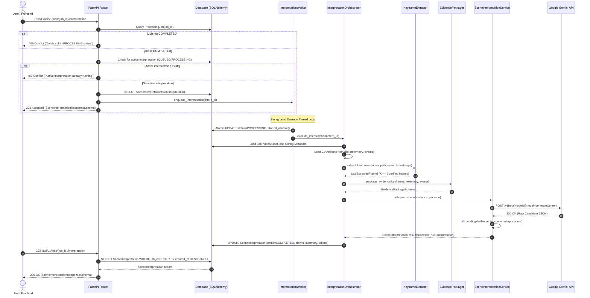

# TrafficLens-AI — VLM Backend Orchestration & Lifecycle Design

**Document Version**: 1.0.0  
**Status**: Approved Architecture Blueprint  
**Reference ADR**: [ADR-0005: Asynchronous Scene Understanding Orchestration and Decoupled Lifecycle Management](file:///c:/Users/bhard/Desktop/TrafficLens%20AI/docs/adr/0005-vlm-job-orchestration.md)  
**Target Milestone**: Milestone 5D

---

## 1. Executive Summary

Milestones 5A, 5B, and 5C established the multimodal building blocks of TrafficLens-AI:
- **Milestone 5A**: Epistemic taxonomy, prompt contracts, and model feasibility evaluation ([ADR-0004](file:///c:/Users/bhard/Desktop/TrafficLens%20AI/docs/adr/0004-vlm-integration-architecture.md)).
- **Milestone 5B**: Deterministic keyframe extraction with verified OpenCV frame-index semantics and null-timestamp integrity ([KeyframeExtractor](file:///c:/Users/bhard/Desktop/TrafficLens%20AI/backend/app/services/vlm/keyframe_extractor.py)), plus structured evidence packaging ([EvidencePackager](file:///c:/Users/bhard/Desktop/TrafficLens%20AI/backend/app/services/vlm/evidence_packager.py)).
- **Milestone 5C**: Native Google Gemini API integration ([GeminiVLMProvider](file:///c:/Users/bhard/Desktop/TrafficLens%20AI/backend/app/services/vlm/gemini_provider.py)), centralized epistemic verification ([GroundingVerifier](file:///c:/Users/bhard/Desktop/TrafficLens%20AI/backend/app/services/vlm/grounding_verifier.py)), and deterministic verified CV fact rendering.

This design document specifies the production backend orchestration layer connecting the computer vision processing pipeline with multimodal Vision-Language Model scene understanding.

### Primary Architectural Objectives

1. **Strict Lifecycle Decoupling**:
   The primary Computer Vision processing job (`ProcessingJob`) and multimodal scene understanding (`SceneInterpretation`) execute with independent lifecycles. A CV job transitions to `COMPLETED` immediately upon finishing video analysis; it is never held in `PROCESSING` waiting for VLM inference, and external VLM failures (HTTP 429 rate limits, provider timeouts, network drops) never fail or invalidate passing CV telemetry.
2. **Dedicated Persistence & Query Model**:
   Scene interpretations are modeled as a dedicated database entity (`scene_interpretations` table) with a 1:N relationship to `processing_jobs`. This enables historical comparisons, multi-model evaluation, and clean retries without re-running expensive video decoding.
3. **Dual-Worker In-Process Concurrency**:
   To preserve the zero-external-dependency deployment profile (supporting 8 GB RAM developer laptops) while avoiding starvation, CV processing and VLM queries run on dedicated in-process workers (`JobWorker` and `InterpretationWorker`) backed by separate bounded queues and background daemon threads.
4. **Crash Consistency & Fault Tolerance**:
   Startup reconciliation marks interrupted in-flight tasks as `FAILED` (`INTERRUPTED_BY_SHUTDOWN`) and dynamically redispatches queued tasks up to capacity.
5. **Verified Epistemic Grounding**:
   Before any interpretation is committed as `COMPLETED`, it passes through the centralized `GroundingVerifier`, guaranteeing that visual observations cite valid keyframes and CV facts agree with structured telemetry before deterministic rendering.

---

## 2. System Architecture & Component Interaction

### 2.1 High-Level Architecture Diagram

```mermaid
flowchart TD
    subgraph Client["Client Tier (Frontend / API Consumer)"]
        UI["Web Dashboard / HTTP Client"]
    end

    subgraph API["FastAPI Application Tier"]
        JobRouter["/api/v1/jobs Router"]
        InterpRouter["/api/v1/jobs/{job_id}/interpretation Router"]
    end

    subgraph Storage["Persistence & Filesystem"]
        DB[(SQLite / PostgreSQL DB)]
        DiskArtifacts["Artifacts Store: data/artifacts/{job_id}/"]
        VideoStore["Video Store: storage/uploads/"]
    end

    subgraph Workers["Background Concurrency Tier"]
        subgraph CVWorkerSub["CV Worker Thread (TrafficLens-Worker)"]
            CVQueue["CV Queue (Bounded queue.Queue)"]
            CVPipeline["CVPipelineAdapter (YOLO11n + ByteTrack + Analytics)"]
        end

        subgraph VLMWorkerSub["VLM Worker Thread (TrafficLens-InterpretationWorker)"]
            VLMQueue["Interpretation Queue (Bounded queue.Queue)"]
            Orchestrator["InterpretationOrchestratorService"]
        end
    end

    subgraph VLMServiceTier["VLM Services Tier"]
        KFExtract["KeyframeExtractor (OpenCV verified index)"]
        Packager["EvidencePackager"]
        SceneService["SceneInterpretationService"]
        Provider["GeminiVLMProvider (REST API)"]
        Verifier["GroundingVerifier"]
    end

    subgraph External["External Cloud Services"]
        GeminiAPI["Google Gemini REST API (/v1beta/models/{model})"]
    end

    UI -->|1. POST /jobs| JobRouter
    JobRouter -->|Save QUEUED job| DB
    JobRouter -->|Enqueue job_id| CVQueue
    CVQueue --> CVPipeline
    CVPipeline -->|Read raw video| VideoStore
    CVPipeline -->|Save analytics.json & events| DiskArtifacts
    CVPipeline -->|Mark COMPLETED| DB

    UI -->|2. POST /jobs/{id}/interpretation (On-demand)| InterpRouter
    CVPipeline -.->|Optional auto-trigger if enabled| InterpRouter
    InterpRouter -->|Create QUEUED SceneInterpretation| DB
    InterpRouter -->|Enqueue interpretation_id| VLMQueue

    VLMQueue --> Orchestrator
    Orchestrator -->|Claim PROCESSING| DB
    Orchestrator -->|Load telemetry & events| DiskArtifacts
    Orchestrator -->|Extract K<=5 frames| KFExtract
    KFExtract -->|Read video| VideoStore
    Orchestrator -->|Assemble EvidencePackage| Packager
    Orchestrator -->|Invoke interpretation| SceneService
    SceneService --> Provider
    Provider -->|HTTP POST inlineData| GeminiAPI
    Provider -->|Structured JSON| Verifier
    Verifier -->|Validated & Rendered Claims| SceneService
    SceneService -->|Persist COMPLETED interpretation| DB
    UI -->|3. GET /jobs/{id}/interpretation| InterpRouter
    InterpRouter -->|Read latest interpretation| DB
```

### 2.2 End-to-End Execution Sequence Diagram



---

## 3. Domain Entities & Database Schema

### 3.1 `SceneInterpretation` Model Specification

The database model is implemented in `backend/app/models/scene_interpretation.py` using SQLAlchemy 2.0 mapped columns and inherits from `backend.app.models.base.Base`.

```python
class SceneInterpretationStatus(str, Enum):
    QUEUED = "QUEUED"
    PROCESSING = "PROCESSING"
    COMPLETED = "COMPLETED"
    FAILED = "FAILED"
```

| Column Name | SQL Type | Nullable | Description & Constraints |
| :--- | :--- | :---: | :--- |
| `id` | `VARCHAR(36)` | No | Primary Key. Format: `interp_<12-hex-uuid>`. |
| `job_id` | `VARCHAR(36)` | No | Foreign Key to `processing_jobs.id` (`ondelete="CASCADE"`). Indexed. |
| `video_id` | `VARCHAR(36)` | No | Foreign Key to `video_assets.id` (`ondelete="CASCADE"`). Indexed. |
| `status` | `VARCHAR(20)` | No | Enum: `QUEUED`, `PROCESSING`, `COMPLETED`, `FAILED`. Indexed. |
| `created_at` | `UTCDateTime` | No | Timestamp of creation. Default: `utcnow`. Indexed. |
| `started_at` | `UTCDateTime` | Yes | Timestamp when worker claimed task into `PROCESSING`. |
| `completed_at` | `UTCDateTime` | Yes | Timestamp of terminal state transition (`COMPLETED` or `FAILED`). |
| `duration_seconds`| `FLOAT` | Yes | Total execution time in seconds (`completed_at - started_at`). |
| `provider_type` | `VARCHAR(50)` | No | Active provider identifier (e.g., `gemini`, `openai_compatible`, `mock`). |
| `model_name` | `VARCHAR(100)`| No | Specific model identifier used (e.g., `gemini-3.8-flash`). |
| `prompt_tokens` | `INTEGER` | Yes | Tokens evaluated in multimodal prompt. |
| `completion_tokens`| `INTEGER` | Yes | Tokens generated in candidate completion. |
| `total_tokens` | `INTEGER` | Yes | Sum of prompt and completion tokens. |
| `summary` | `TEXT` | Yes | High-level natural language scene description. |
| `environmental_context` | `JSON` | Yes | Weather, lighting, pavement condition, camera angle. |
| `scene_description` | `JSON` | Yes | Roadway topology, lane count, static hazards. |
| `event_interpretations` | `JSON` | Yes | Serialized list of grounded traffic event explanations. |
| `epistemic_claims` | `JSON` | Yes | Grounded claims array (`cv_fact`, `visual_observation`, `inference`, `unverified`). |
| `unverified_aspects` | `JSON` | Yes | List of explicitly unverified or occluded scene aspects. |
| `evidence_package_id` | `VARCHAR(100)` | Yes | Package ID referencing keyframes and telemetry slice used. |
| `error_code` | `VARCHAR(100)`| Yes | Standardized error string if `status == FAILED`. |
| `error_message` | `TEXT` | Yes | Human-readable failure explanation. |
| `error_details` | `JSON` | Yes | Detailed diagnostic metadata (stack trace, safety block reason). |

### 3.2 Database Indexes & Constraints

To guarantee sub-millisecond query performance on status polling and enforce database-level concurrency safeguards:
1. `ix_scene_interpretations_id`: Primary key index on `id`.
2. `ix_scene_interpretations_job_id`: Index on foreign key `job_id`.
3. `ix_scene_interpretations_video_id`: Index on foreign key `video_id`.
4. `ix_scene_interpretations_status`: Index on `status`.
5. `ix_scene_interpretations_job_created`: Composite index on `("job_id", "created_at")` for efficient retrieval of the latest interpretation for any job.
6. `uix_active_interpretation_per_job`: **Partial unique index** on `(job_id)` where `status IN ('QUEUED', 'PROCESSING')`. Supported natively by SQLite (3.8.0+) and PostgreSQL, this provides a database-enforced safeguard preventing more than one active interpretation per CV job, even under concurrent requests.

### 3.3 Alembic Migration Plan

The migration will be created under `alembic/versions/` (e.g. `0004_create_scene_interpretations_table.py`):
- `upgrade()`:
  - Creates the `scene_interpretations` table.
  - Adds indices, including partial unique index `uix_active_interpretation_per_job`.
  - Adds foreign key constraints with `ondelete="CASCADE"`.
- `downgrade()`:
  - Drops indices.
  - Drops table `scene_interpretations`.

---

## 4. State Machines & Lifecycle Transitions

### 4.1 Transition Rules Table

The lifecycle rules for `SceneInterpretation` are strictly enforced by a state transition validator (`validate_interpretation_status_transition`). Both `COMPLETED` and `FAILED` are **terminal states**; records are immutable once terminal.

| Current Status | Target Status | Permitted? | Condition & Action |
| :--- | :--- | :---: | :--- |
| `QUEUED` | `PROCESSING` | ✅ Yes | Worker claims interpretation task; sets `started_at = now()`. |
| `QUEUED` | `FAILED` | ✅ Yes | Startup recovery or queue discard if aborted before claiming. |
| `PROCESSING` | `COMPLETED` | ✅ Yes | Pipeline successfully finished; sets `completed_at = now()`. Terminal state. |
| `PROCESSING` | `FAILED` | ✅ Yes | Pipeline encountered error, timeout, or shutdown; sets `completed_at = now()`. Terminal state. |
| `COMPLETED` | *Any* | ❌ No | Terminal state. To re-analyze, a new interpretation record must be created. |
| `FAILED` | *Any* | ❌ No | Terminal state. Retries create a **new interpretation record** linked to the same job. |

### 4.2 Non-Blocking Invariant

```
INVARIANT:
Status of ProcessingJob in {QUEUED, PROCESSING, COMPLETED, FAILED}
is NEVER mutated by SceneInterpretationWorker or SceneInterpretationService.
```

- If `ProcessingJob` reaches `COMPLETED`, its status remains `COMPLETED` forever regardless of whether `SceneInterpretation` succeeds, times out, or fails.
- If `SceneInterpretation` fails with `RATE_LIMIT_EXCEEDED`, the user can still download video artifacts, inspect detection summaries, view tripwire counts, and analyze flow charts.

---

## 5. Worker & Queue Architecture (`InterpretationWorker`)

### 5.1 Concurrency Model

Video processing (`JobWorker`) and multimodal scene interpretation (`InterpretationWorker`) have fundamentally different resource profiles:

| Dimension | `JobWorker` (CV Pipeline) | `InterpretationWorker` (VLM) |
| :--- | :--- | :--- |
| **Primary Resource** | CPU / GPU (Inference, Decoding) | Network I/O (REST HTTP, JSON Parsing) |
| **Duration** | 10 seconds – 3 minutes (proportional to video length) | 2 – 8 seconds (API latency + retry backoff) |
| **Concurrency Limit** | 1 active job (to prevent GPU/RAM OOM) | 1 active interpretation (configurable to 2–4 if remote) |
| **Failure Profile** | Corrupt video, decoder failure, OOM | HTTP 429 rate limit, 5xx gateway, network timeout |
| **Queue Type** | `queue.Queue[str]` (Job IDs) | `queue.Queue[str]` (Interpretation IDs) |

### 5.2 `InterpretationWorker` Implementation Architecture

Resides in `backend/app/services/vlm_worker.py`:

```python
class InterpretationWorker:
    """
    Dedicated in-process background worker for multimodal scene understanding.
    Runs in a standalone daemon thread with its own bounded queue.
    """
    def __init__(self):
        self.settings = get_settings()
        self._queue: queue.Queue[str] = queue.Queue(maxsize=self.settings.INTERPRETATION_MAX_QUEUE_SIZE)
        self._queued_ids: set[str] = set()
        self._thread: Optional[threading.Thread] = None
        self._stop_event = threading.Event()
        self._running_interp_id: Optional[str] = None
        self._lock = threading.Lock()
        self._last_redispatch_check: float = 0.0

    def start(self) -> None:
        """Starts worker daemon thread and executes startup crash recovery."""
        ...

    def stop(self, timeout: float = 5.0) -> None:
        """Signals stop event, joins thread, and fails in-flight task if stuck."""
        ...

    def enqueue_interpretation(self, interpretation_id: str) -> None:
        """Enqueues interpretation ID. Raises QueueFullError if bounded queue is at max capacity."""
        ...

    def recover_interpretations(self) -> None:
        """
        1. Identifies any SceneInterpretation in PROCESSING state and marks FAILED (INTERRUPTED_BY_SHUTDOWN).
        2. Scans for persisted QUEUED tasks and redispatches into active queue up to capacity.
        """
        ...
```

### 5.3 Thread-Local Async Execution Bridge & Deployment Constraints

Because `SceneInterpretationService.interpret_scene()` is an `async` coroutine (using `httpx.AsyncClient`), while `InterpretationWorker` runs on a background OS thread:
- The worker executes the async pipeline inside an isolated event loop:
  ```python
  loop = asyncio.new_event_loop()
  asyncio.set_event_loop(loop)
  try:
      result = loop.run_until_complete(orchestrator.execute_async(interp_id))
  finally:
      loop.close()
  ```
- This completely isolates background network I/O from the main FastAPI server's ASGI event loop, guaranteeing that slow VLM calls never increase API request latency.

#### Explicit Deployment Constraint: Single Application Process Only
The current architecture (in-process `queue.Queue`, background `threading.Thread`, and `threading.Lock` concurrency guards) strictly assumes a **single application process** (`uvicorn backend.app.main:app --workers 1`).
- Multiple Uvicorn workers (`--workers > 1`) or multi-instance horizontal scaling are explicitly **not supported**. In a multi-worker deployment, in-memory queues would diverge, in-process mutexes would fail to coordinate, and startup reconciliation in one worker could prematurely mark active tasks in another worker as failed.
- **Future Migration Seam**: To scale horizontally across multiple worker processes or nodes (Phase 6), the architecture provides a clean migration path: replace `queue.Queue` with a database-backed distributed queue using row-level locking (`SELECT ... FOR UPDATE SKIP LOCKED` on PostgreSQL) or an external broker (Redis/Celery), while leaving domain entities, validation logic, and API contracts unchanged.

---

## 6. Execution Pipeline & Service Orchestration

The execution pipeline is coordinated by `InterpretationOrchestratorService` in `backend/app/services/vlm/orchestrator.py`:

```
+----------------------------------------------------------------------------------+
|                  InterpretationOrchestratorService Pipeline                      |
+----------------------------------------------------------------------------------+
  1. Atomic DB Claim:
     UPDATE scene_interpretations SET status='PROCESSING', started_at=now()
     WHERE id=:interp_id AND status='QUEUED'
     [Guarantees exactly-once execution across concurrent scans]
                           |
                           v
  2. Artifact & Context Retrieval:
     - Load ProcessingJob record (sequence_name, video_id, config_metadata)
     - Load VideoAsset (storage_path, verified duration, fps)
     - Load persisted artifacts from data/artifacts/{job_id}/:
       * analytics_summary.json (stopped vehicle events, line crossings, ROI flow)
       * tracking_summary.json (unique tracker IDs, active durations)
       * detection_summary.json (detection counts by vehicle class)
                           |
                           v
  3. Deterministic Keyframe Extraction:
     KeyframeExtractor.extract_keyframes(
         video_path=storage_path,
         events=stopped_events,
         config=ExtractionConfigSchema(frame_budget=5, max_dimension=960)
     )
     [Respects OpenCV verified frame indices, null-timestamp preservation, K <= 5 budget]
                           |
                           v
  4. Structured Evidence Packaging:
     EvidencePackager.package_evidence(
         video_id=video_id,
         job_id=job_id,
         sequence_name=sequence_name,
         extracted_keyframes=keyframes,
         analytics_summary=analytics_summary,
         tracking_summary=tracking_summary,
         detection_summary=detection_summary
     )
     [Produces strongly-typed EvidencePackageSchema with verified telemetry & events]
                           |
                           v
  5. Multimodal Inference & Epistemic Grounding:
     SceneInterpretationService.interpret_scene(evidence_package)
     -> Provider executes Google Gemini REST API request with responseSchema
     -> GroundingVerifier validates visual observations & CV fact content
     -> Deterministic rendering safeguard replaces CV fact free-text with verified metrics
                           |
                           v
  6. Single Atomic Persistence & Completion:
     - On Success (Single Atomic Transaction):
       UPDATE scene_interpretations SET
         status='COMPLETED', completed_at=now(), duration_seconds=...,
         summary=..., environmental_context=..., scene_description=...,
         event_interpretations=..., epistemic_claims=...,
         unverified_aspects=..., prompt_tokens=..., completion_tokens=...,
         total_tokens=...
       WHERE id=:interp_id AND status='PROCESSING'
       [MANDATORY: Status and result fields committed in one atomic commit]
     - On Failure (Single Atomic Transaction):
       UPDATE scene_interpretations SET
         status='FAILED', completed_at=now(), duration_seconds=...,
         error_code=..., error_message=..., error_details=...
       WHERE id=:interp_id AND status='PROCESSING'
```

---

## 7. API Contracts & Endpoint Specifications

All endpoints are mounted under `backend/app/api/routes/interpretation.py` and registered into `backend/app/api/router.py`.

### 7.1 `POST /api/v1/jobs/{job_id}/interpretation`

Enqueues scene interpretation for a completed CV job.

- **URL**: `/api/v1/jobs/{job_id}/interpretation`
- **Method**: `POST`
- **Path Parameter**: `job_id` (string, required)
- **Request Body** (optional):
  ```json
  {
    "provider_type": "gemini",
    "model_name": "gemini-3.8-flash",
    "frame_budget": 5,
    "temperature": 0.2
  }
  ```
- **Concurrency & Validation Rules**:
  - Guarded by process-level mutex `_interpretation_create_lock = threading.Lock()` and database partial unique index `uix_active_interpretation_per_job`.
  - Verifies that `ProcessingJob` is in `COMPLETED` status.
  - Queries total interpretation attempts for `job_id`. If `count >= MAX_INTERPRETATION_ATTEMPTS` (3), rejects with `409 Conflict`.
  - Queries active interpretations for `job_id`. If any record is in `QUEUED` or `PROCESSING` status, rejects with `409 Conflict`.
- **Responses**:
  - `202 Accepted`: Task successfully created and enqueued.
    ```json
    {
      "id": "interp_a1b2c3d4e5f6",
      "job_id": "job_9876543210ab",
      "video_id": "vid_1234567890cd",
      "status": "QUEUED",
      "created_at": "2026-11-23T11:30:00Z",
      "started_at": null,
      "completed_at": null,
      "duration_seconds": null,
      "provider_type": "gemini",
      "model_name": "gemini-3.8-flash",
      "summary": null,
      "error": null
    }
    ```
  - `400 Bad Request`: Primary CV job is in `FAILED` status (`"Cannot interpret scene for a failed CV job."`).
  - `404 Not Found`: `job_id` does not exist.
  - `409 Conflict`: 
    - Primary CV job is currently `QUEUED` or `PROCESSING` (`"CV processing must complete before scene interpretation can be triggered."`).
    - An active interpretation is already `QUEUED` or `PROCESSING` for this job (`"An active interpretation is already in progress for this job."`).
    - Attempt limit reached (`"Maximum interpretation attempt limit (3) exhausted for this job."`).
  - `503 Service Unavailable`: Interpretation worker queue is at maximum capacity (`QueueFullError`).

### 7.2 `GET /api/v1/jobs/{job_id}/interpretation`

Fetches the latest scene interpretation for a job.

- **URL**: `/api/v1/jobs/{job_id}/interpretation`
- **Method**: `GET`
- **Path Parameter**: `job_id` (string, required)
- **Responses**:
  - `200 OK`:
    - Case A: Interpretation exists (returns full `SceneInterpretationResponseSchema` with `status="COMPLETED"`, `summary`, `epistemic_claims`, etc., or `status="PROCESSING"` / `status="QUEUED"` / `status="FAILED"`).
    - Case B: No interpretation has been requested for this job yet. Returns a virtual response with:
      ```json
      {
        "id": null,
        "job_id": "job_9876543210ab",
        "video_id": "vid_1234567890cd",
        "status": "NOT_REQUESTED",
        "created_at": null,
        "started_at": null,
        "completed_at": null,
        "duration_seconds": null,
        "summary": null,
        "error": null
      }
      ```
  - `404 Not Found`: `job_id` does not exist.

### 7.3 `GET /api/v1/jobs/{job_id}/interpretations`

Fetches the complete historical list of interpretation runs for a job (ordered by `created_at DESC`).

- **URL**: `/api/v1/jobs/{job_id}/interpretations`
- **Method**: `GET`
- **Responses**:
  - `200 OK`: Returns `List[SceneInterpretationResponseSchema]`.
  - `404 Not Found`: `job_id` does not exist.

### 7.4 `POST /api/v1/jobs/{job_id}/interpretation/retry`

Retries a failed interpretation by creating a **new immutable interpretation attempt record**.

- **URL**: `/api/v1/jobs/{job_id}/interpretation/retry`
- **Method**: `POST`
- **Concurrency & Validation Rules**:
  - Guarded by `_interpretation_create_lock = threading.Lock()`.
  - Verifies latest interpretation exists and is in `FAILED` status. If not, returns `400 Bad Request`.
  - Verifies total interpretation records for `job_id` $< MAX_INTERPRETATION_ATTEMPTS$ (3). If $count \ge 3$, rejects with `409 Conflict` (`"Maximum interpretation attempt limit (3) exhausted for this job."`).
  - Verifies no active interpretation (`QUEUED` or `PROCESSING`) exists. If so, returns `409 Conflict`.
  - Inserts a **new `SceneInterpretation` row** (`interp_<uuid>`) with `status=QUEUED` referencing the same `job_id` and `video_id`.
  - Dispatches new task ID to `InterpretationWorker`.
- **Ambiguous Timeout Warning**:
  > [!WARNING]
  > If the previous failure was caused by `VLM_PROVIDER_TIMEOUT`, the external provider may have completed inference after the client socket timed out. A retry initiates a brand new `generateContent` request and **can incur an additional Gemini API charge**. At-least-once external execution semantics apply.
- **Responses**:
  - `202 Accepted`: New interpretation record created in `QUEUED` status and enqueued.
  - `400 Bad Request`: Latest interpretation is not in `FAILED` status (`"Only failed interpretations can be retried."`).
  - `404 Not Found`: No interpretation found for `job_id`.
  - `409 Conflict`: Active interpretation is currently in progress, or attempt limit (3) is exhausted.
  - `503 Service Unavailable`: Queue is full.

---

## 8. Failure Modes & Recovery Strategy

### 8.1 Error Taxonomy

Standardized error codes stored in `SceneInterpretation.error_code`:

| Error Code | HTTP Status / Trigger | Retry Allowed? | Remediation Strategy |
| :--- | :--- | :---: | :--- |
| `INTERRUPTED_BY_SHUTDOWN` | Server restarted or crashed while task was `PROCESSING`. | ✅ Yes | Recovered at boot; user can retry via API. |
| `QUEUE_FULL` | In-process bounded queue reached `maxsize`. | ✅ Yes | Rejected upfront with HTTP 503; client retries after backoff. |
| `VIDEO_FILE_MISSING` | Source video file deleted from `storage/uploads/`. | ❌ No | Fatal error; requires re-upload of video. |
| `ARTIFACTS_MISSING` | CV pipeline artifacts missing from `data/artifacts/`. | ❌ No | Fatal error; requires re-running CV processing job. |
| `KEYFRAME_EXTRACTION_FAILED` | OpenCV failed to decode video frames. | ✅ Yes | Logged with decoding warnings; retried if transient. |
| `VLM_PROVIDER_TIMEOUT` | Gemini API request exceeded `VLM_REQUEST_TIMEOUT` (30s). | ✅ Yes | Exponential backoff retry performed by provider; fails gracefully if sustained. User can retry (incurs new API call). |
| `VLM_RATE_LIMIT_EXCEEDED` | HTTP 429 quota exhaustion. | ✅ Yes | Bounded exponential jitter retries; surfaces clear quota error to user. |
| `VLM_SAFETY_BLOCK` | Gemini safety filters blocked prompt or response candidate. | ❌ No | Recorded in `error_details` with `blockReason`; unverified claims disclosed. Non-retryable with identical input. |
| `GROUNDING_VALIDATION_FAILED`| Output violated schema or could not be parsed. | ✅ Yes | Isolated by verifier; unverified fallback returned. |
| `VLM_DISABLED` | `VLM_ENABLED=False` in configuration. | ❌ No | Requires administrator to enable VLM in backend settings. |

### 8.2 Application Lifecycle Management & Crash Recovery

```python
# In backend/app/main.py lifespan context:
@asynccontextmanager
async def lifespan(app: FastAPI):
    # 1. Startup: Start CV JobWorker
    job_worker = get_job_worker()
    job_worker.start()
    
    # 2. Startup: Start InterpretationWorker & recover crashed tasks
    interp_worker = get_interpretation_worker()
    interp_worker.start()
    
    yield
    
    # 3. Shutdown: Gracefully stop InterpretationWorker (5s timeout)
    interp_worker.stop(timeout=5.0)
    
    # 4. Shutdown: Gracefully stop JobWorker (5s timeout)
    job_worker.stop(timeout=5.0)
```

#### Startup Recovery Semantics:
1. **Reconciliation of Interrupted Runs**: Identifies all `SceneInterpretation` records in `PROCESSING` status (interrupted by server restart or crash) and marks them as `FAILED` with `error_code="INTERRUPTED_BY_SHUTDOWN"`.
2. **Queued Redispatch**: Scans the database for persisted `QUEUED` interpretation records not in memory and redispatches them into the active queue up to capacity.
3. **No Automatic Retry of External Calls**: Interrupted tasks are never automatically retried by the startup routine to prevent infinite crash loops, cascading provider throttling, or runaway API charges. At-least-once external execution semantics require explicit client intervention for retries.

---

## 9. Testing Strategy

The test suite must validate all decoupled orchestration invariants without making external network calls or requiring local GPU models:

1. **State Machine & Schema Unit Tests** (`test_interpretation_state_machine.py`):
   - Validates all allowed transitions (`QUEUED` $\to$ `PROCESSING` $\to$ `COMPLETED` / `FAILED`; `FAILED` $\to$ `QUEUED`).
   - Asserts rejection of illegal transitions (`COMPLETED` $\to$ `QUEUED`, `FAILED` $\to$ `PROCESSING`).
   - Asserts strict Pydantic serialization of `SceneInterpretationResponseSchema`.
2. **Repository & Database Integration Tests** (`test_interpretation_repository.py`):
   - Tests CRUD operations on SQLite in-memory test database.
   - Verifies cascade deletion (deleting `ProcessingJob` deletes all associated `SceneInterpretation` records).
   - Verifies `get_latest_by_job_id()` ordering.
3. **Worker Concurrency & Recovery Tests** (`test_interpretation_worker.py`):
   - Verifies queue bounding: enqueuing beyond capacity raises `QueueFullError`.
   - Tests startup recovery: pre-populating database with `PROCESSING` tasks and verifying they are marked `FAILED` with `INTERRUPTED_BY_SHUTDOWN`.
   - Tests graceful shutdown timeout handling.
4. **API Endpoint Integration Tests** (`test_interpretation_endpoints.py`):
   - Tests `POST /jobs/{id}/interpretation` on `QUEUED`, `PROCESSING`, and `FAILED` jobs, verifying expected 409 and 400 status codes.
   - Tests `POST /jobs/{id}/interpretation` on `COMPLETED` job, verifying 202 Accepted.
   - Tests `GET /jobs/{id}/interpretation` on job with no interpretation, verifying virtual `NOT_REQUESTED` payload.
   - Tests `POST /jobs/{id}/interpretation/retry` on failed interpretation.
5. **End-to-End Orchestrator Pipeline Tests** (`test_interpretation_orchestrator.py`):
   - Mocks `KeyframeExtractor` and uses `MockVLMProvider`.
   - Verifies that `ProcessingJob` remains `COMPLETED` even when `MockVLMProvider` raises an error or is disabled.

---

## 10. Implementation Plan & Work Breakdown

The implementation of Milestone 5D is decomposed into 7 granular tickets tracked in `.scratch/vlm-orchestration/issues/`:
- **Issue 01**: Database Model, Schema & Alembic Migration (`scene_interpretations` table).
- **Issue 02**: Pydantic v2 Contracts & `SceneInterpretationRepository`.
- **Issue 03**: `InterpretationWorker` In-Process Bounded Queue & Crash Recovery.
- **Issue 04**: `InterpretationOrchestratorService` Execution Pipeline.
- **Issue 05**: FastAPI HTTP Routes & Router Registration.
- **Issue 06**: Optional Automatic Post-Processing Trigger Hook in `JobWorker`.
- **Issue 07**: Comprehensive Unit, API & Worker Integration Test Suite.