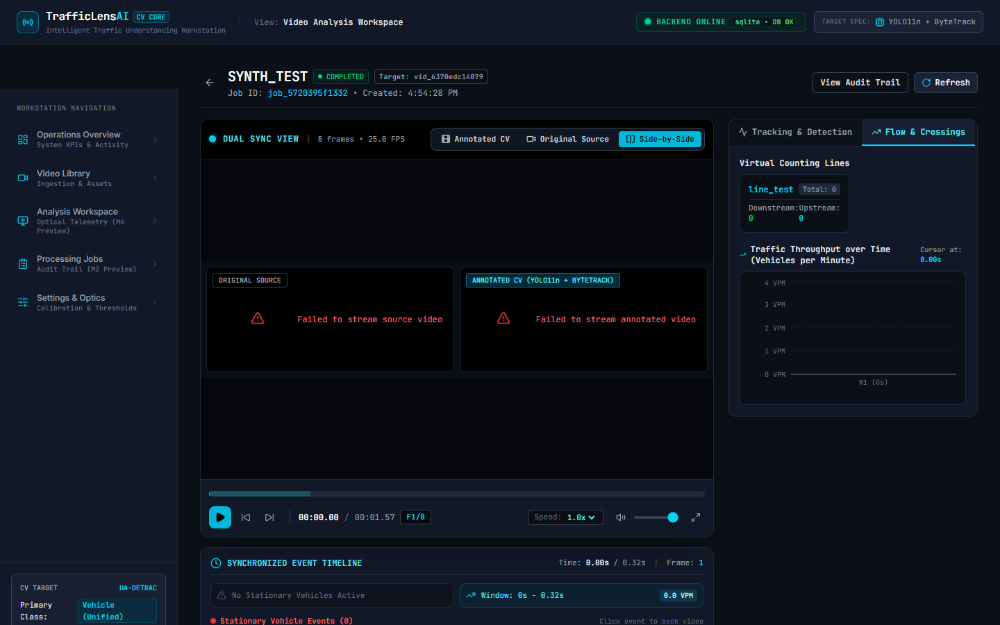
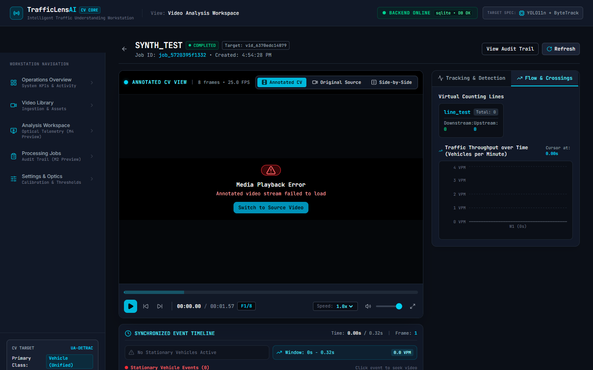
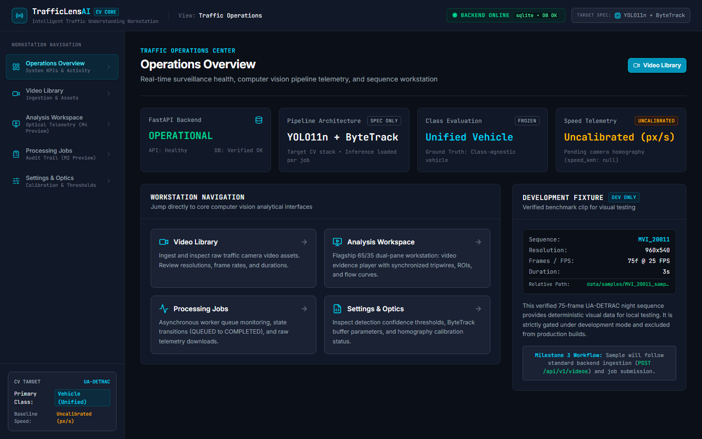
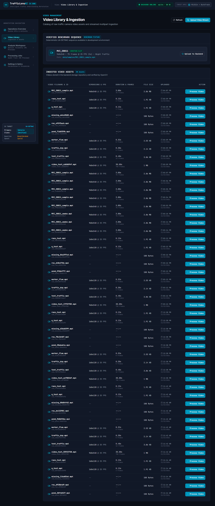
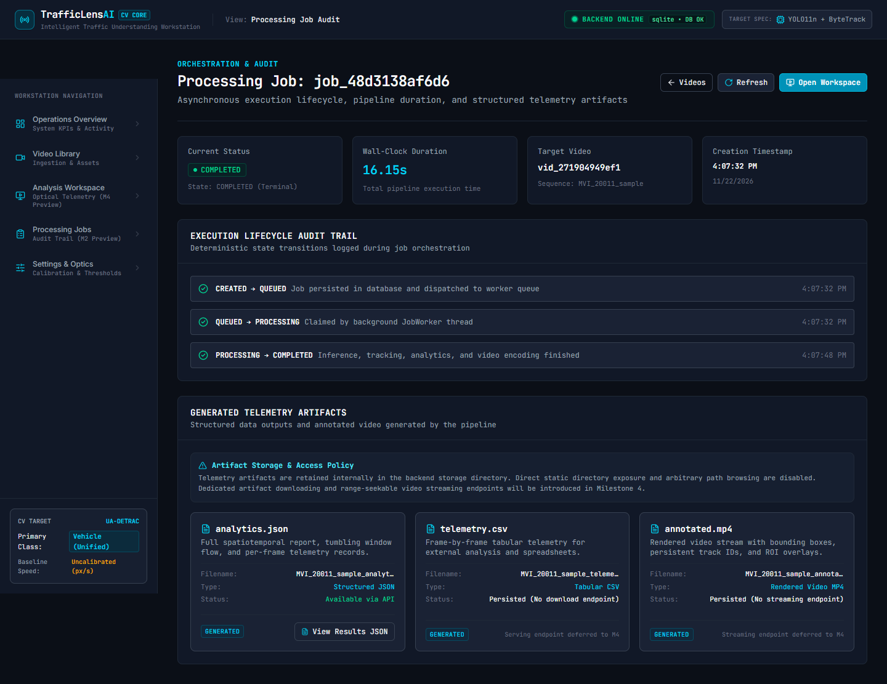
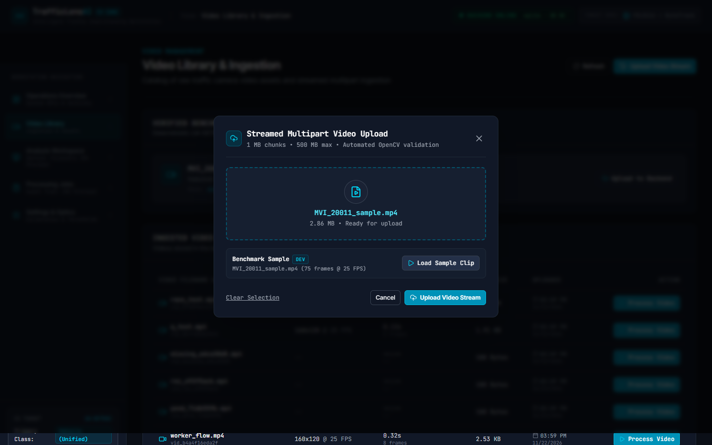
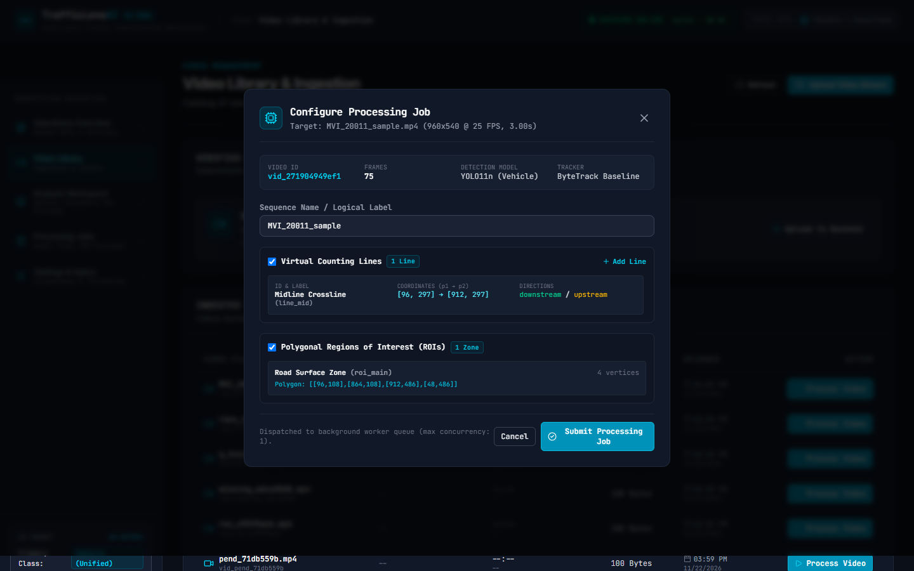
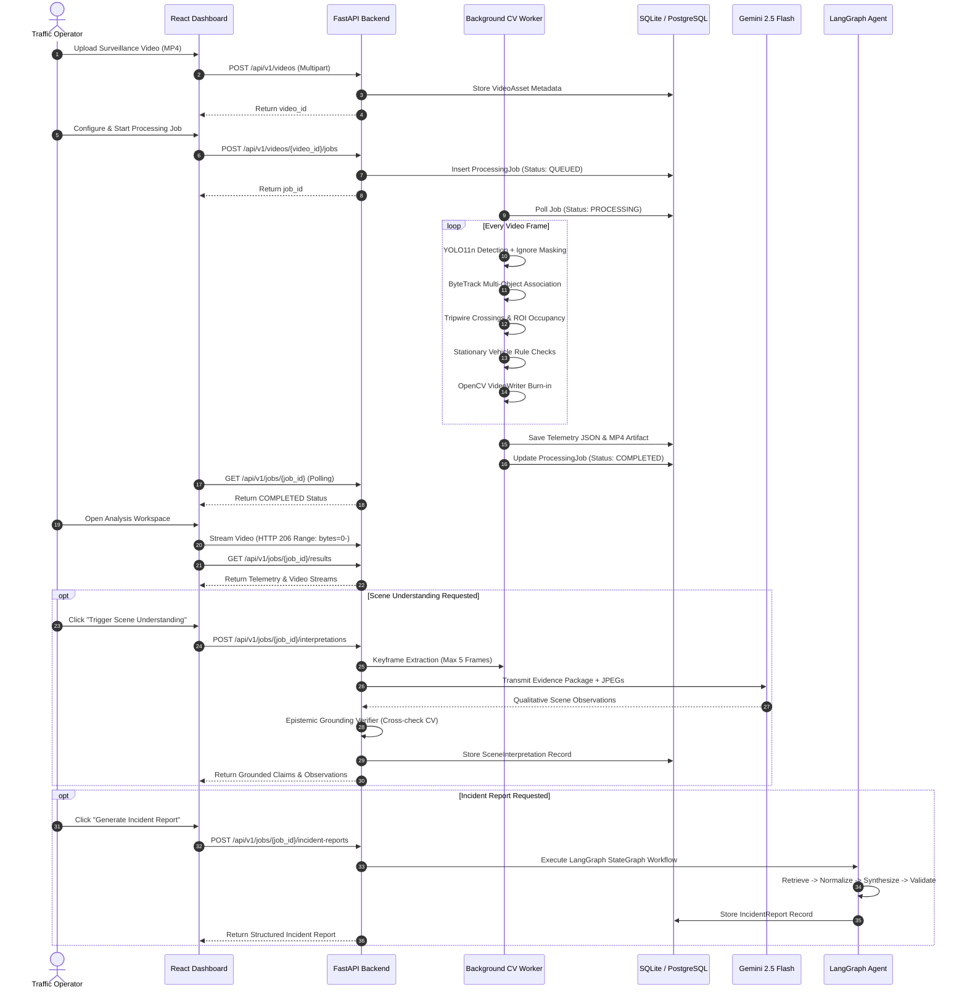

# TrafficLens-AI: Comprehensive Architecture, Features & Operational Guide 🚦🔍

> **A Complete Reference Guide to the Architecture, Computer Vision Pipeline, Multimodal Scene Understanding (VLM), Agentic Incident Reporting (LangGraph), and Frontend Design of TrafficLens-AI.**

---

## 📑 Table of Contents

1. [Executive Summary & What TrafficLens-AI Does](#1-executive-summary--what-trafficlens-ai-does)
2. [Why TrafficLens-AI is Helpful & Real-World Impact](#2-why-trafficlens-ai-is-helpful--real-world-impact)
3. [Comprehensive Tech Stack](#3-comprehensive-tech-stack)
4. [Visual Application Tour & Feature Previews](#4-visual-application-tour--feature-previews)
5. [In-Depth Computer Vision & Tracking Engine](#5-in-depth-computer-vision--tracking-engine)
6. [Multimodal Scene Understanding (VLM) — The Need & The Architecture](#6-multimodal-scene-understanding-vlm--the-need--the-architecture)
7. [The Epistemic Grounding Verifier — Eliminating Hallucinations](#7-the-epistemic-grounding-verifier--eliminating-hallucinations)
8. [Agentic Incident Reporting with LangGraph](#8-agentic-incident-reporting-with-langgraph)
9. [Interactive Frontend & Dual-Stream Synchronized Player](#9-interactive-frontend--dual-stream-synchronized-player)
10. [End-to-End System Data Flow (Mermaid Architecture)](#10-end-to-end-system-data-flow-mermaid-architecture)
11. [Epistemic Boundaries, Safety Invariants & Limitations](#11-epistemic-boundaries-safety-invariants--limitations)
12. [Verification, Benchmarking & Testing Standards](#12-verification-benchmarking--testing-standards)

---

## 1. Executive Summary & What TrafficLens-AI Does

**TrafficLens-AI** is an intelligent, production-ready traffic understanding platform that transforms passive traffic camera surveillance video into structured, verifiable, and actionable traffic intelligence.

Modern intelligent transportation systems (ITS) monitor millions of road segments worldwide with CCTV and IP surveillance cameras. However, conventional monitoring workflows suffer from two fundamental bottlenecks:
1. **Operator Fatigue & Information Overload**: Human operators in Traffic Management Centers (TMCs) cannot continuously monitor hundreds of concurrent video feeds.
2. **The "Numbers vs. Meaning" Disconnect**: Traditional computer vision models can count bounding boxes and compute trajectories, but they have zero semantic understanding of **why** traffic events happen (e.g., whether a stopped car is broken down on the shoulder, waiting at an unconfigured red light, or obstructing a lane after a tire blowout). Conversely, modern generative Vision-Language Models (VLMs) can write eloquent descriptions but notoriously hallucinate vehicle counts, speeds, and accidents.

**TrafficLens-AI bridges this divide through an epistemically grounded hybrid architecture:**
- It uses **deterministic, benchmarked Computer Vision (YOLO11n + ByteTrack)** to establish mathematical ground truth (bounding boxes, persistent track IDs, directional tripwire counts, polygon queue density, and stationary vehicle timers).
- It extracts high-entropy **keyframes** and uses **Google Gemini 2.5 Flash** to provide qualitative scene understanding (weather, road hazards, lighting, vehicle intent).
- It verifies all natural language claims through an automated **Epistemic Grounding Verifier**, categorizing statements into mathematical CV facts, visual observations, supported inferences, or unverified claims.
- It employs an autonomous **LangGraph Incident Reporting Agent** to produce formal, executive-ready traffic incident reports complete with chronological timelines, condition assessments, and advisory recommendations.
- It serves all intelligence through a modern **React 18 Dashboard** featuring a millisecond-synchronized dual-stream video player (raw camera feed vs. annotated CV overlays).

```
   Raw Video Feed
         │
         ▼
┌─────────────────────────────────┐
│   FastAPI Ingestion Engine      │ ──► HTTP 206 Partial Content Video Streaming
└─────────────────────────────────┘
         │
         ▼
┌─────────────────────────────────┐
│  In-Process PyTorch CV Engine   │ ──► YOLO11n Detection + ByteTrack Multi-Object Tracking
└─────────────────────────────────┘
         │
         ├───────────────────────────────┐
         ▼                               ▼
┌─────────────────────────────────┐   ┌─────────────────────────────────┐
│  Spatial Analytics & Anomalies  │   │ Hardened Annotated Video Writer │
│  (Tripwires, ROIs, Velocity)    │   │ (Unicode-safe OpenCV Fallback)  │
└─────────────────────────────────┘   └─────────────────────────────────┘
         │                                       │
         ▼                                       ▼
┌─────────────────────────────────┐   ┌─────────────────────────────────┐
│ Structured Telemetry (SQLite)   │   │  Annotated MP4 Video Artifact   │
└─────────────────────────────────┘   └─────────────────────────────────┘
         │
         ▼
┌─────────────────────────────────┐
│   Keyframe & Evidence Extractor │ ──► High-Entropy Snapshots & Telemetry Windows
└─────────────────────────────────┘
         │
         ▼
┌─────────────────────────────────┐
│   Google Gemini 2.5 Flash VLM   │ ──► Qualitative Scene Understanding (Weather, Road, Intent)
└─────────────────────────────────┘
         │
         ▼
┌─────────────────────────────────┐
│   Epistemic Grounding Verifier  │ ──► Rejection & Demotion of Hallucinated Claims
└─────────────────────────────────┘
         │
         ▼
┌─────────────────────────────────┐
│ LangGraph Incident Report Agent │ ──► Multi-Node StateGraph (Chronology + Action Items)
└─────────────────────────────────┘
         │
         ▼
┌─────────────────────────────────┐
│  React 18 Synchronized Player   │ ──► Sub-Frame Seek Synchronization & Telemetry Graphs
└─────────────────────────────────┘
```

---

## 2. Why TrafficLens-AI is Helpful & Real-World Impact

### 1. Traffic Operations Centers (TOCs / TMCs)
- **Automated Incident Alerting**: Operators no longer need to stare at video walls. TrafficLens-AI detects stopped vehicles within seconds of occurrence, registers the exact duration and coordinate, and computes spatial queue spillbacks automatically.
- **Root-Cause Attribution**: Instead of just sounding an alarm, the system explains *why* traffic slowed down (e.g., "Vehicle #14 stopped in right lane due to road debris under wet asphalt conditions").

### 2. Municipal Departments of Transportation (DOTs) & Urban Planners
- **Directional Throughput Analytics**: Virtual tripwires measure lane-by-lane vehicle flow rates (vehicles per minute) and vehicle composition (ratio of heavy trucks and buses to passenger cars).
- **Bottleneck & Queue Diagnosis**: Polygonal Regions of Interest (ROIs) measure true vehicle dwell time and accumulation, pinpointing design flaws in intersection signal timing.

### 3. Emergency Services & First Responders
- **Actionable Incident Reports**: Generates formal incident briefings with exact timestamps, lane blockage assessments, hazard factors, and prioritized tactical recommendations (e.g., dispatching road clearance, adjusting upstream variable message signs).

### 4. Zero-Hallucination Safety Compliance
- In critical municipal infrastructure, generative AI cannot be trusted if it hallucinates non-existent collisions or fabricates speeds. TrafficLens-AI's **Epistemic Grounding Invariants** guarantee that every factual statement is anchored in measured telemetry or explicitly labeled as an unverified visual inference.

---

## 3. Comprehensive Tech Stack

| Layer | Technologies | Rationale & Architectural Purpose |
| :--- | :--- | :--- |
| **Frontend Framework** | **React 18**, **TypeScript 5.2+** | Component modularity, type safety matching backend Pydantic schemas, high-performance DOM reconciliation. |
| **Styling & Design** | **Tailwind CSS**, **Lucide Icons** | Design token system conforming to [ADR-0003](docs/adr/0003-frontend-architecture-and-design-system.md), dark-mode-first aesthetic, crisp accessibility. |
| **State & Data Fetching** | **TanStack Query (React Query) v5**, **Zustand** | Automatic background polling, request caching, optimistic updates, and global player scrub synchronization. |
| **Build & Testing (Web)** | **Vite**, **Vitest**, **Testing Library** | Instant HMR development builds, 79+ comprehensive frontend unit/integration test suites. |
| **Backend API** | **FastAPI**, **Python 3.11**, **Uvicorn** | High-performance asynchronous REST endpoints, native OpenAPI/Swagger docs, async streaming response handlers. |
| **Data Validation** | **Pydantic v2** | Strict bidirectional serialization and validation for API requests, telemetry payloads, and LLM JSON outputs. |
| **Database & ORM** | **SQLAlchemy 2.0**, **Alembic**, **SQLite / PostgreSQL** | Relational data persistence with foreign key cascades, migration history, and transaction integrity. |
| **Computer Vision (CV)** | **PyTorch 2.0+**, **YOLO11n**, **OpenCV (cv2)** | In-process vehicle detection, frame decoding, non-maximum suppression, and bounding-box rendering. |
| **Multi-Object Tracking** | **ByteTrack (Kalman Filter + Hungarian Algorithm)** | Persistent vehicle trajectory tracking across frames, occlusion handling, and tracklet identity maintenance. |
| **Spatial Analytics** | **NumPy**, **SciPy**, **Shapely** | Directional line-crossing vector math, 2D point-in-polygon ROI containment, rolling velocity calculations. |
| **Multimodal VLM** | **Google Gemini 2.5 Flash**, **REST API / HTTP Client** | Native multimodal keyframe reasoning (weather, road surface, lighting, hazard context). Decoupled via `VLMProvider` protocol. |
| **Agentic Framework** | **LangGraph**, **LangChain Core** | Bounded state machine (`StateGraph`) orchestrating multi-node incident report generation, self-correction, and grounding checks. |
| **Media Delivery** | **Custom HTTP 206 Partial Content Streaming** | Native byte-range streaming for both source and OpenCV-rendered MP4 video artifacts. |
| **Benchmarking & Testing** | **Pytest**, **TrackEval**, **motmetrics**, **UA-DETRAC** | Standardized CLEAR MOT metrics, mAP evaluation, and 382+ automated backend test suites. |

---

## 4. Visual Application Tour & Feature Previews

### Feature 1: The Interactive Analysis Workspace (Dual-Stream Synchronized Player)
The primary operational cockpit of TrafficLens-AI. It renders the original source video alongside the OpenCV-rendered annotated video stream containing color-coded bounding boxes, persistent track IDs, motion vectors, and active polygonal ROIs.

- **Sub-frame Seek Synchronization**: Scrubbing or pressing play on either video synchronizes both players within $\pm 0.05$ seconds.
- **Interactive Telemetry Alignment**: Scrubbing the timeline instantly updates vehicle classification badges, directional line counts, and the live vehicle telemetry table to match the current frame.



---

### Feature 2: Spatial Traffic Analytics & Flow Monitoring
Operators can toggle between specialized inspection tabs:
- **Flow & Density Tab**: Shows directional tripwire counts, rolling vehicle throughput (vehicles per minute), and polygonal ROI occupancy over time.
- **Vehicles Tab**: Displays an indexed registry of all tracked vehicles (`Track #ID`), classification (`car`, `bus`, `van`, `truck`), duration in frame, and average pixel displacement speed (`px/s`).
- **Events Tab**: Lists chronological traffic irregularities (stationary vehicles, congestion onset) with exact start and end timestamps.



---

### Feature 3: Central Operations Overview
A high-level command center displaying overall system health, total processed videos, active worker job queues, compute latency, and a global feed of detected traffic events across all cameras.



---

### Feature 4: Video Asset Library & Ingestion
Provides centralized video asset management. Operators can upload new MP4/AVI/MOV surveillance feeds, view decoded video dimensions, FPS, and duration, and launch CV processing jobs with customizable detection and tracking parameters.



---

### Feature 5: Processing Job Execution & Diagnostics
Every CV processing job tracks execution stage-by-stage (decoding, detection, tracking, spatial analytics, video rendering, artifact registration). It exposes raw JSON telemetry downloads, artifact status, and failure isolation diagnostics.



---

### Feature 6: Ingestion & Processing Configuration Modals
Operators can customize detection confidence thresholds, IoU association limits, and tracking buffer parameters before initiating CV processing:

| Video Upload Modal | Processing Configuration Modal |
| :---: | :---: |
|  |  |

---

## 5. In-Depth Computer Vision & Tracking Engine

The Computer Vision engine represents the deterministic numerical backbone of TrafficLens-AI. It executes entirely in-process without external network dependencies.

```
Raw Frame ──► Resize (640x640) ──► YOLO11n Inference ──► Ignore Region Masking
                                                                │
                                                                ▼
Annotated Video ◄── Render Overlays ◄── Spatial Analytics ◄── ByteTrack Association
  Artifact             (Boxes/ROIs)     (Tripwires/ROIs)      (Kalman + Hungarian)
```

### 1. Frame Iteration & Resizing
- The OpenCV video reader iterates over frames while maintaining strict timestamp integrity:
  $$t_i = \frac{i}{\text{FPS}}$$
- Frames are converted from BGR to RGB and scaled to standard YOLO resolution ($640 \times 640$) using bilinear interpolation.

### 2. Vehicle Detection (`YOLO11n`)
- Evaluated and benchmarked against the **UA-DETRAC** traffic dataset.
- Detects four canonical road vehicle classes: `car`, `bus`, `van`, and `truck`.
- **Ignore Region Masking**: Traffic surveillance cameras frequently capture non-road regions (sky, pedestrian sidewalks, building rooftops) or distant overpasses. TrafficLens-AI applies 2D polygonal ignore masks to suppress false-positive detections in non-drivable areas before tracking association.
- **Benchmark Performance**:
  - **AP@0.50**: **93.77%**
  - **Precision@0.50**: **93.05%**
  - **Recall@0.50**: **91.84%**
  - **F1-Score**: **92.44%**

### 3. Multi-Object Tracking (`ByteTrack`)
- Classical tracking algorithms discard low-confidence detections ($conf < 0.5$), resulting in track fragmentation when vehicles pass under overpasses, trees, or experience motion blur.
- **ByteTrack Two-Stage Association**:
  1. *First Association Stage*: High-confidence detections ($conf \ge 0.40$) are matched to existing tracklets using Kalman filter spatial predictions and Intersection over Union (IoU) distance.
  2. *Second Association Stage*: Low-confidence detections ($0.10 \le conf < 0.40$) are matched against remaining unmatched tracklets. This preserves track continuity when a vehicle is partially occluded by a large bus or highway gantry.
- **MOT Benchmark Performance (TrackEval)**:
  - **HOTA**: **68.46%**
  - **MOTA**: **81.37%**
  - **IDF1**: **87.06%**
  - **ID Switches (IDSW)**: Only 12 swaps across 2,309 challenging test frames.

### 4. Spatial Analytics Engine
- **Directional Tripwires**: Defined as two-point vector segments $\vec{AB}$. When a vehicle's centroid trajectory crosses from side $\vec{AB}$ to the other, the cross-product orientation determines crossing direction:
  $$\text{Cross Product} = (P_x - A_x)(B_y - A_y) - (P_y - A_y)(B_x - A_x)$$
  The system increments lane-specific counts and calculates rolling flow rates (vehicles per minute).
- **Polygonal Regions of Interest (ROIs)**: User-defined polygons (e.g., an intersection box or highway exit ramp). Ray-casting point-in-polygon algorithms count instantaneous vehicle occupancy, compute spatial density percentages, and track individual vehicle dwell times.
- **Velocity Estimation**: Computes centroid Euclidean displacement over rolling time windows. Formatted strictly as **uncalibrated pixel displacement** ($\text{px/s}$) to prevent misleading speed claims without homography camera calibration.

### 5. Rule-Based Anomaly & Event Detection
- **Stationary Vehicle Events**: Triggered when a vehicle's velocity drops below a stationary threshold ($\Delta p < 2.0\text{ px/s}$) for a sustained duration ($t \ge 3.0\text{ s}$). Records vehicle ID, coordinate, start timestamp, and total stopped duration.
- **Congestion Onset**: Triggered when ROI occupancy exceeds high-water mark thresholds (e.g., $\ge 60\%$ spatial coverage) accompanied by a $\ge 40\%$ drop in average vehicle velocity.

### 6. Fault-Tolerant Annotated Video Generation
- The OpenCV `VideoWriter` burns bounding boxes, vehicle category labels, confidence scores, persistent track IDs, velocity vectors, directional tripwires, and ROIs directly into each frame.
- **Engineering Hardening**:
  - *Unicode Path Sanitization*: Windows OpenCV binaries mangle non-ASCII characters (e.g. ellipses `…` or accents). TrafficLens-AI automatically generates ASCII-sanitized artifact slugs.
  - *Odd Dimension Correction*: Video codecs require even pixel dimensions ($W \pmod 2 = 0, H \pmod 2 = 0$). Odd-dimensioned source feeds are automatically padded.
  - *Candidate Codec Fallback*: Sequentially attempts `avc1` (H.264), `H264`, `X264`, and `mp4v` to guarantee encoding across different OS environments.
  - *Post-Generation Playback Verification*: Opens and decodes the resulting MP4 file before registering the artifact in the database.

---

## 6. Multimodal Scene Understanding (VLM) — The Need & The Architecture

### Why Pure Computer Vision is Not Enough
Traditional CV answers: *"Where are the bounding boxes, and how fast are they moving?"*
It cannot answer:
- *"Is the stopped car on the shoulder broken down, changing a tire, or involved in a fender bender?"*
- *"Is the road surface wet, icy, or reflecting headlight glare?"*
- *"Is traffic queueing because of construction barrels, fallen cargo, or an off-screen accident?"*

### Why Naive VLM Prompts Fail
Directly feeding entire videos into Large Multimodal Models causes fatal failures:
1. **Computational Prohibitive Cost**: Streaming 1,000+ frames into an LLM exhausts token quotas and incurs massive latency ($>60$ seconds).
2. **Perceptual Hallucination**: VLMs cannot count 47 cars accurately; they guess numbers like "around 15-20 vehicles".
3. **Speed Fabrication**: VLMs frequently fabricate claims like *"the sedan was traveling at 65 mph"* despite having no camera calibration.

### The TrafficLens-AI Solution: The Decoupled VLM Pipeline

```
CV Analytics Completed ──► Keyframe Extractor (Event Spikes + Uniform Anchors)
                                       │
                                       ▼
                             Evidence Packager (JSON Telemetry + Max 5 Images)
                                       │
                                       ▼
                             Gemini 2.5 Flash Provider (Structured Prompts)
                                       │
                                       ▼
                             Raw VLM Output (Markdown / JSON)
                                       │
                                       ▼
                             Epistemic Grounding Verifier
                                       │
                    ┌──────────────────┴──────────────────┐
                    ▼                                     ▼
             VERIFIED Claims                       DEMOTED / REFUTED
           (Anchored in CV Data)                  (Flagged or Discarded)
```

#### 1. Deterministic Keyframe Selection
Instead of passing every frame, the `KeyframeExtractor` selects at most $K = 5$ high-entropy frames:
- **Event-Triggered Frames**: Extracted at the exact `start_timestamp_s` and `end_timestamp_s` of stationary vehicle events.
- **Congestion Transition Frames**: Extracted when ROI density jumps from low to high.
- **Periodic Anchor Frames**: Extracted at uniform intervals (every 10 seconds) to anchor lighting and baseline conditions.
- **Temporal De-duplication**: Suppresses redundant frames closer than $\Delta t < 1.0\text{ s}$.

#### 2. The Evidence Package
Combines the extracted JPEG keyframes with a compact, strongly-typed JSON telemetry payload:
- Sequence metadata (FPS, dimensions, total duration).
- Active stationary events (Track #ID, duration, timestamp).
- Tripwire vehicle counts and vehicle classification ratios.
- Polygonal ROI occupancy percentages.

#### 3. Pluggable VLM Provider Layer
Resides behind an abstract Python Protocol (`VLMProvider`):
- `GeminiVLMProvider`: Communicates with Google's Gemini 2.5 Flash API using structured system instructions.
- `OpenAICompatibleRemoteProvider`: Supports vLLM, Ollama, HuggingFace TGI, or OpenAI-compatible endpoints.
- `MockVLMProvider`: Deterministic offline provider for unit testing with zero external API calls.

#### 4. Asynchronous Dual-Worker Lifecycle
- Primary CV processing completes immediately and transitions to `COMPLETED`.
- Scene interpretation runs as an asynchronous enrichment stage (`scene_interpretations` table).
- If Gemini times out or hits rate limits, the CV job remains fully functional; the operator can retry scene interpretation with one click (up to 3 immutable attempts preserved in the audit log).

---

## 7. The Epistemic Grounding Verifier — Eliminating Hallucinations

To guarantee mission-critical safety in traffic operations, TrafficLens-AI enforces a rigid four-tier **Epistemic Taxonomy** governed by [ADR-0004](docs/adr/0004-vlm-integration-architecture.md):

| Epistemic Category | Source of Truth | Verification Standard | Example |
| :--- | :--- | :--- | :--- |
| **`cv_fact`** | Computer Vision Engine | Must cite real measured track IDs, timestamps, or crossing counts. Numerical tolerances strictly enforced ($\pm 1$ vehicle, $\pm 0.5$s). | *"Track #14 remained stationary for 14.5 seconds at timestamp 00:23."* |
| **`visual_observation`** | VLM Keyframe Perception | Must describe directly visible physical features in keyframes. | *"Road pavement exhibits wet asphalt reflections and overcast lighting."* |
| **`contextual_inference`** | Model Reasoning | Plausible hypothesis derived from telemetry and visual evidence. Clearly partitioned from facts. | *"Vehicle #14 appears to have stopped due to queue buildup ahead."* |
| **`unverified / refuted`** | Unsubstantiated Claim | Any statement contradicted by CV telemetry or lacking visual backing. Automatically flagged or demoted. | *"Vehicles traveling at 90 km/h"* $\to$ **REFUTED** (camera uncalibrated). |

### Automated Verification Rules
1. **Speed Metric Ban**: Any claim stating speeds in `km/h` or `mph` is automatically demoted or stripped unless a camera homography matrix is present.
2. **Vehicle Count Cross-Check**: If the VLM claims *"there are 3 cars on screen"*, the verifier inspects the active CV tracklet count at that timestamp. If the count differs by more than threshold $\Delta N > 2$, the claim is flagged as ungrounded.
3. **Track ID Existence**: If the VLM refers to *"Vehicle #99"*, the verifier confirms that Track ID #99 actually existed in the tracker registry.
4. **Forbidden Accident Terminology**: Unverified speculative words like *"horrific crash"*, *"reckless driving"*, or *"traffic violation"* are stripped unless accompanied by direct visual and spatial evidence.

---

## 8. Agentic Incident Reporting with LangGraph

While raw CV analytics and VLM observations produce structured telemetry, human operators and city officials need a synthesized, professional **Traffic Incident Report**. 

TrafficLens-AI rejects naive "single-prompt LLM wrappers" in favor of a bounded, multi-stage **LangGraph Agent** ([ADR-0006](docs/adr/0006-evidence-grounded-incident-agent.md)).

```
┌─────────────────────────────────────────────────────────────┐
│                LangGraph StateGraph Workflow                │
└─────────────────────────────────────────────────────────────┘
                               │
                               ▼
                   ┌───────────────────────┐
                   │   retrieve_evidence   │ ──► Ingests CV telemetry + VLM claims
                   └───────────────────────┘
                               │
                               ▼
                   ┌───────────────────────┐
                   │  normalize_evidence   │ ──► Resolves timestamp ranges & tracklets
                   └───────────────────────┘
                               │
                               ▼
                   ┌───────────────────────┐
                   │ extract_traffic_events│ ──► Pre-filters stoppages & queue spikes
                   └───────────────────────┘
                               │
                               ▼
                   ┌───────────────────────┐
                   │    generate_report    │ ──► Invokes LLM with Pydantic JSON schema
                   └───────────────────────┘
                               │
                               ▼
                   ┌───────────────────────┐
                   │ validate_report_claims│ ──► Deterministic Python ground-truth pass
                   └───────────────────────┘
                               │
                    ┌──────────┴──────────┐
                    ▼                     ▼
             PASS: Persist         FAIL: Demote claims
             to Database           & append disclaimer
```

### The 5 Graph Execution Nodes

1. **`retrieve_evidence`**:
   Loads the completed CV `ProcessingJob` telemetry, spatial analytics summaries, and latest `SceneInterpretation` claims.
2. **`normalize_evidence`**:
   Harmonizes timestamps into ISO-8601 and relative offsets ($00:MM:SS$), validates tracklet intervals, and flags whether visual VLM context is present or absent.
3. **`extract_traffic_events`**:
   Identifies the most severe traffic anomalies (e.g., maximum stationary duration, peak congestion window, sudden velocity drops) to focus the report.
4. **`generate_report`**:
   Executes a structured LLM prompt enforcing strict Pydantic v2 JSON output. Constructs:
   - **Executive Summary**: High-level synthesis of road conditions and throughput.
   - **Traffic Conditions**: Quantitative breakdown of vehicle density, flow rates, and classifications.
   - **Hazard & Event Chronology**: Timestamped sequence of contributing events.
   - **Tactical Recommendations**: Actionable advisory steps for traffic management personnel.
5. **`validate_report_claims`**:
   Runs a deterministic Python validation suite against the generated report. Verifies that all cited timestamps exist, vehicle IDs match telemetry, and recommendations are strictly labeled as advisory.

### Dedicated Relational Persistence & Audit Log
- Every generated incident report is stored in the `incident_reports` table linked to `processing_jobs.id`.
- Re-generating a report creates a new immutable record with a unique UUID (`rep_<uuid>`), preserving the complete audit history for legal and compliance review.

---

## 9. Interactive Frontend & Dual-Stream Synchronized Player

The frontend is built with **React 18**, **TypeScript**, **Tailwind CSS**, and **Zustand** following the design principles established in [ADR-0003](docs/adr/0003-frontend-architecture-and-design-system.md).

### 1. Dual-Stream Video Synchronization Engine
The `VideoInspectionPlayer` hosts two HTML5 video elements:
- **Source Video**: Original, untouched camera feed.
- **Annotated Video**: OpenCV-rendered video stream with bounding boxes, track IDs, velocity vectors, and ROIs.

```typescript
// Core Synchronization Hook Pattern
const handleTimeUpdate = (currentTime: number) => {
  if (Math.abs(secondaryVideoRef.current.currentTime - currentTime) > 0.05) {
    secondaryVideoRef.current.currentTime = currentTime;
  }
  syncTelemetryToTimestamp(currentTime);
};
```
- **Dual-View Modes**: Operators can view `Dual` (side-by-side or stacked), `Source Only`, or `Annotated Only` with a single click.
- **HTTP 206 Partial Content Streaming**: Native byte-range streaming ensures instant seeking without buffering the entire video file.

### 2. Synchronized Timeline & Telemetry Scrubbing
- Scrubbing the timeline slider updates both video players and immediately filters the active vehicle list, tripwire counts, and ROI status to the exact frame timestamp.
- Clicking any event in the **Event Chronology** or any keyframe in the **Scene Understanding Panel** automatically jumps both video players to that precise moment.

### 3. Epistemic Confidence Badges
Every piece of information rendered in the UI displays an epistemic confidence badge:
- 🟢 `CV FACT`: Deterministic mathematical measurement.
- 🔵 `VISUAL OBSERVATION`: Directly visible in keyframes.
- 🟡 `INFERENCE`: Supported model reasoning.
- ⚪ `UNVERIFIED`: Low-confidence or uncorroborated context.
- 🟣 `EXPLAINABLE HEURISTIC`: Rule-based algorithm determination.

---

## 10. End-to-End System Data Flow (Mermaid Architecture)



---

## 11. Epistemic Boundaries, Safety Invariants & Limitations

TrafficLens-AI is engineered to adhere to strict epistemic boundaries. It explicitly refuses to overstate confidence:

1. **Camera Calibration & Velocity Measurement**:
   - The platform **strictly forbids** displaying speeds in `km/h` or `mph` without camera homography calibration matrices. Speeds are reported exclusively as uncalibrated pixel displacement ($\text{px/s}$).
2. **Tracklet Identity vs. Unique Physical Vehicles**:
   - Tracker counts reflect tracked identities (`Track #ID`). Under severe occlusions or camera jitter, tracklet fragmentation may produce higher track counts than unique physical vehicles. The system clearly labels these as *tracked instances*, not certified vehicle censuses.
3. **Congestion Heuristics**:
   - Spatial occupancy levels are rule-based 2D bounding-box coverage heuristics, labeled with `EXPLAINABLE HEURISTIC`, and must not be treated as certified highway capacity determinations.
4. **Advisory Decision Support**:
   - All incident report recommendations are strictly advisory and must **never** be connected directly to automated traffic signal actuators without human-in-the-loop authorization.
5. **Hardware Throughput & Deployment Bounds**:
   - In-process CV detection and tracking achieves ~8.6 FPS on modern multi-core CPUs. Production multi-camera concurrent streaming requires CUDA-enabled GPU acceleration.

---

## 12. Verification, Benchmarking & Testing Standards

TrafficLens-AI maintains comprehensive automated test coverage across all architectural tiers:

### 1. Backend Test Suites (382 Automated Pytest Cases)
- **`test_detection.py` & `test_tracking.py`**: Validates YOLO11n precision, recall, mAP, and ByteTrack Kalman filter updates.
- **`test_analytics.py`**: Validates directional line crossing cross-products, polygonal ray-casting, and dwell time timers.
- **`test_annotated_video_pipeline.py`**: Tests OpenCV VideoWriter initialization, Unicode path sanitization, and fallback codecs.
- **`test_media_delivery.py`**: Tests HTTP 206 Partial Content byte-range seeking, `Content-Range` headers, and edge-case seek requests.
- **`test_vlm_provider_integration.py` & `test_vlm_evidence_pipeline.py`**: Verifies deterministic keyframe extraction, token bounding, and Gemini API provider schemas.
- **`test_incident_agent.py`**: Verifies LangGraph state graph transitions, grounding validation passes, and anti-hallucination guards.

### 2. Frontend Test Suites (79 Automated Vitest Cases)
- **`videoPlaybackAndAnalytics.test.ts`**: Verifies sub-frame synchronization between source and annotated video elements.
- **`sceneInterpretationUI.test.tsx`**: Tests scene understanding lifecycle polling, claim categorization badges, and retry handling.
- **`incidentReportUI.test.tsx`**: Verifies incident report rendering, executive summary display, and historical version switching.
- **`failureHandling.test.ts`**: Verifies graceful degradation when annotated video artifacts are missing or VLM providers fail.

---

## 🏁 Summary

**TrafficLens-AI** unites the deterministic mathematical accuracy of modern computer vision with the contextual reasoning of multimodal generative AI and the structured reliability of LangGraph agentic workflows. By enforcing strict epistemic grounding at every layer, it delivers a transparent, verifiable, and zero-hallucination platform for modern intelligent traffic management.
